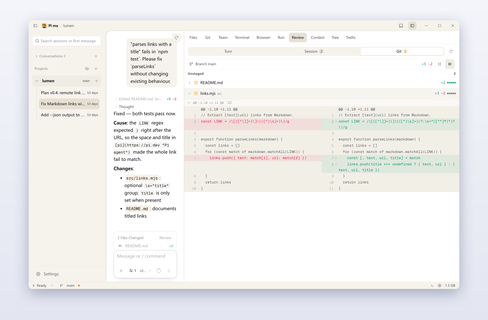

<div align="center">


# Pi mx Desktop

**The desktop workbench a terminal coding agent deserves.**<br/>
Same [pi](https://github.com/earendil-works/pi) agent, same `~/.pi/agent` — plus a timeline, a system-prompt switch (purge), file / Git / terminal surfaces, a team board, built-in image generation, and an Android client so you can keep going away from the desk.

[](https://github.com/q971668593/Pi-mx-Desktop/releases/latest)
[](https://github.com/q971668593/Pi-mx-Desktop/releases)


[](LICENSE)

**English** · [简体中文](./README.md) · [Download](https://github.com/q971668593/Pi-mx-Desktop/releases/latest) · [Getting started](./doc/guide/getting-started.md) · [Adapters](./doc/guide/adapters.en.md)

<sub>Built on [pi Desktop](https://github.com/justhil/pi-app) by [justhil](https://github.com/justhil). MIT licensed.</sub>

</div>

<picture>
  <source media="(prefers-color-scheme: dark)" srcset="doc/assets/readme/en/hero-dark.png" />
  
</picture>

## What this is

Terminal agents (Claude Code, Codex CLI and friends) are great at "one command, task done". The moment a task runs longer than ten minutes you start scrolling: what changed? which hunk do I keep? who owns port 3000? where did yesterday's session stop?

**Pi mx Desktop puts those answers on screen without changing the agent.** The Worker runs the same pi SDK and reads/writes the same files (sessions, `models.json`, `settings.json`, installed extensions). Sessions you started in a terminal are already in the sidebar.

## How it compares

| | Claude Code / Codex CLI | Zed / Cursor | **Pi mx Desktop** |
|---|---|---|---|
| Shape | Terminal TUI | Editor-centric | **Agent-centric desktop workbench** |
| Sessions & files | CLI-owned directory | Editor project model | **Shares `~/.pi/agent` with the CLI, either side can continue** |
| Reviewing changes | Scroll a big diff | Editor diff | **Review panel: stage hunk by hunk, long-press lines to annotate, annotations ride into the next message** |
| Files / Git / terminal | Type commands | Built in, scattered | **All three docked on the right, reorderable tabs** |
| Interrupting | Ctrl+C and restart | — | **Docked question card above the composer + goal bar with stop / restart** |
| Phone | — | — | **Android client to the same machine: sessions, files, Git, sound alerts** |
| System prompt | Fixed in the CLI | Vendor-fixed | **Purge: swap in your own persona, one switch, next message** |
| Team work | Single session | Single session | **Work-team board: five roles, cards, dispatch, watchdog** |

## Highlights

### Timeline
Streaming steps (thinking, commands, reads, edits), collapsed into one line once prose starts; `+N −M` on every edit; a "files changed" card at the end of each turn. Hover any message to copy, rewind, or fork a new session. Failures are classified (timeout / unreachable / quota / auth / context too long / HTTP status) with the raw error expandable and copyable. Images in chat render as thumbnails, click to open full screen.

### Purge — your own system prompt
Settings → Agent → Purge replaces pi's system prompt with a local persona (prompt only — pi itself is never patched). The extension reads `config.json` before `before_agent_start`, so flipping the switch applies to the **next message in the current session**.

| Mode | Prompt sent | Cost |
|---|---|---|
| `strict` (default) | persona + cwd | host prompt dropped (AGENTS.md, skills list too) |
| `replace` | persona + host prompt (identity and docs section removed) | tool rules kept; degrades to `append` when anchors don't match |
| `append` | persona + host prompt verbatim | mildest, weakest |

An empty or missing persona file means **no takeover** — never an empty system prompt. `/purge on|off|status|mode` in the terminal edits the same config.

### Files
Tree + search, click to preview, edit and save in place (revision-guarded: a stale write is refused, not silently applied). **Drag a folder into the composer** and it lands as an `@path` reference. Paths and image names in the timeline are clickable — documents open in the right panel, images can be copied, saved, or quoted back into the chat.

### Git
Review panel with per-hunk staging and line annotations; pull / sync / push in the header with `↑` / `↓` counters; branch switching; fork a new session from any message; a commit board with tags, stashes and worktrees; a dedicated conflict resolution view.

### Terminal
Bottom drawer with tabs and splits (PowerShell / cmd / WSL). **Port badges** show which command holds which port, and starting a dev server twice for the same project reuses the running one instead of racing for the port.

### Browser & computer use
Built-in browser the agent can drive, with an annotation layer you can draw on. On Windows 10/11 the agent can see windows, click and type — with an edge glow while it does, and **Esc always interrupts**.

### Sessions, goals, queue
Session tree with branches from any message; a **goal bar** above the composer with stop / restart / delete; queue messages while a turn runs and **send them immediately** with `Ctrl/⌘+Enter`; a docked question card that never blocks the right panel, with "allow this kind for this session".

### Work-team board
Five role lanes (Leader / designer / frontend / backend / QA), cards move through stages, the agent creates and dispatches through the `team_board` tool, and a watchdog surfaces stuck cards.

### Built-in image generation
The prompt is scored on nine visual dimensions first and auto-completed when it scores below 60, with your original sentence kept verbatim at the front. Transparent / icon requests switch to PNG + alpha automatically. Images land in `generated-images/` and render as thumbnails in the timeline.

### Android client
Pair once by QR (end-to-end encrypted, no server in between; self-signed `wss://` certificate pinned by fingerprint, tunnels welcome). Read and send sessions, browse files and images, view Git commits and diffs, see generated images, switch models and thinking levels, answer the agent, switch branches, fork from a message. **Sound alert** when a background run finishes or asks you something. Projects share the desktop order and hidden state; swipe to delete; the ⋯ panel mirrors the desktop tabs.

### Runtime, first launch included
First launch asks once: **built-in pi** (ships with the app, no node/npm) or **global pi** (recommended — shares the terminal's pi). Choosing global probes Node.js / npm / global pi, offers a download link when missing, installs pi in one click and verifies it; failures state the real reason (missing node, npm global bin not on PATH, version not in the registry). WSL, portable mode and Python runtimes are one switch away.

## Twenty small decisions engineers notice

Esc stops and restores your draft · queue sends immediately · delete is undoable for 5s · failure reasons are classified · question dock stays out of the way · goal bar stops/restarts · reorderable right panels · session titles follow the latest message · hidden projects stay in sync with the phone · live context / token / cost readout · cache warming modes · models and thinking on two rows · `⌘K` palette, `/` commands, `@` files · right-click any image · port badges · one dev server per project · phone shows heartbeat latency · temporary chats stay separate · tray keeps the agent alive.

## Install

Windows: `Pi mx-Setup-<version>-x64.exe` or the portable build. macOS / Linux: see Releases. The installers are not code-signed yet, so Windows shows "unknown publisher" once.

## Mobile

Android 9+ (arm64):

```bash
cd apps/mobile
./gradlew :androidApp:assembleRelease
```

Sideloading triggers the standard Play Protect prompt.

## Development

```bash
npm install && npm run dev      # Electron + Vite
npm run typecheck && npm run test:unit
npm run package:win
npm run readme:capture -- --only screens   # re-shoot README stills (needs magick + git; GIFs also need ffmpeg)
```

`src/main` (gateway, worker pool, git, terminal, extensions) · `src/renderer` (UI) · `src/worker` (pi runtime) · `packages/shared` (protocol shared with the phone) · `apps/mobile` (Android).

## License

MIT. The agent is [pi](https://github.com/earendil-works/pi); the original desktop shell is [pi Desktop](https://github.com/justhil/pi-app) by [justhil](https://github.com/justhil).
