<div align="center">


# Pi mx Desktop

### The pi terminal agent is already excellent. What it lacks is a desk.

**A desktop workbench around the pi terminal agent — the agent untouched, the process laid out.**

Same `pi`, same `~/.pi/agent`, same extensions and model config.<br />
What you gain is a whole screen: timeline, side-by-side diffs, file tree, real terminals, team board, themes.

[](https://github.com/q971668593/Pi-mx-Desktop/releases/latest)
[](https://github.com/q971668593/Pi-mx-Desktop/releases)


[](LICENSE)

[Download](https://github.com/q971668593/Pi-mx-Desktop/releases/latest) · [Getting started](doc/guide/getting-started.md) · [Adapters](doc/guide/adapters.en.md) · [简体中文](./README.md)

<sub>Built on [pi Desktop](https://github.com/justhil/pi-app) by [justhil](https://github.com/justhil). MIT licensed. Not an official pi product.</sub>

</div>

<picture>
  <source media="(prefers-color-scheme: dark)" srcset="doc/assets/readme/en/hero-dark.png" />
  
</picture>

## First, the part people get wrong: your terminal is intact

| | `pi` in a terminal | Pi mx Desktop |
| --- | --- | --- |
| The agent itself | `@earendil-works/pi-coding-agent` | **Literally the same**, running in a background Worker |
| Session data | `~/.pi/agent/sessions/*.jsonl` | **The same files** — no separate database |
| Models & keys | `~/.pi/agent/models.json` | **The same file**, models configured in the terminal just work |
| Settings & extensions | `~/.pi/agent/settings.json`, `extensions/` | **The same**, installed extensions still load |
| Tools & runtime | Built-in tools, MCP, skills | **All kept**, nothing rewritten or replaced |
| Keep using the terminal | — | **Yes**, either side can pick up the same session |

**No patches to `pi`, no edits in `node_modules`, no second agent core.** The desktop does exactly one thing: it takes what the agent can only scroll past in a terminal and puts it on a screen you can read at once.

> Scripts, CI, `git bisect` — still better in a terminal. This solves a different stretch: **the part where the agent works and the human has to look, judge, and interrupt.**

## One screen, five answers

Ten minutes into a turn you start scrolling: which files changed? which hunk do I keep? who owns port 3000? where did yesterday's session stop? how much context is left?

The desktop answers all five at once:

| Question | In a terminal | Pi mx Desktop |
| --- | --- | --- |
| What did the agent just do | Scroll back line by line | **Timeline**: thinking / commands / reads / edits become steps, collapsing into one line once prose starts |
| Which lines actually changed | `git diff`, then scroll | **Review panel**: stage hunk by hunk, side-by-side diff, annotate specific lines |
| What is in the project | `ls` / `cat` | **Files panel**: tree + search + revision-guarded preview and edit |
| Who holds the port | Guess with `netstat` | **Real terminal**: tabs, splits, port badges, one dev server per project |
| Where the context went | Guess | **Context panel**: user / assistant / each tool type, plus what is left |

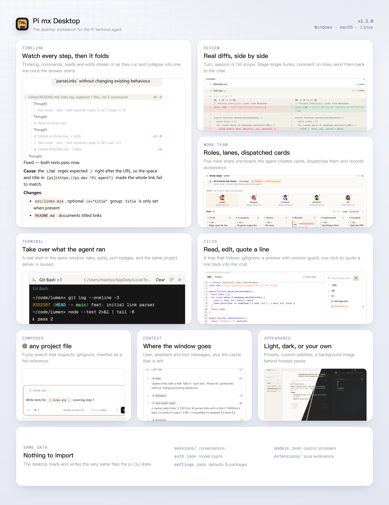

## Six things you won't give back

### 1. Timeline — every step visible, then folded away

Thinking, commands, file reads and edits stream in order; once prose starts, the whole block folds into one line: `Edited README.md, links.mjs · browsed 1 file · ran 2 commands +5 −2`. Open it when you care, let it out of the way when you don't.

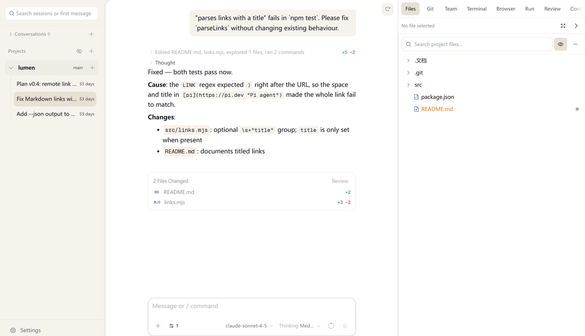

- Thinking chains, Markdown, code blocks and KaTeX render in place; long output stays collapsed.
- Every edit is tagged `+N −M`, and each turn ends with a "files changed" card that opens in Review or the files panel.
- Failures are not one red line: **classified cause (timeout / unreachable / quota / auth / context too long / HTTP status) + the raw error, expandable and copyable**.
- Hover any message: copy, rewind to here, or fork a new session.

### 2. Review — a real diff, side by side

Widen the right panel, switch to Review's Git scope, walk files one by one or stage by hunk; long-press a few lines to annotate, and the annotation rides into the next message — no more re-explaining "why here?".

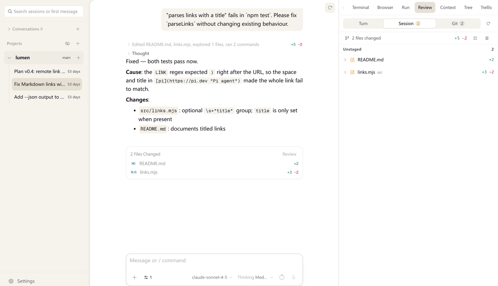

Pull / sync / push sit in the header with `↑` and `↓` counters; branch switching, commit-message generation and conflict resolution each get a real surface.

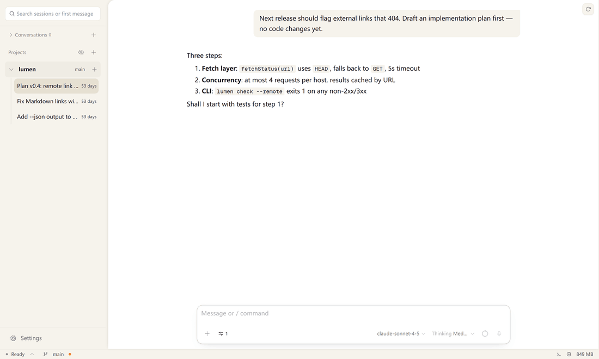

### 3. Files — read, edit, quote a line

Tree + search, `.gitignore` respected; previews are revision-guarded (a stale save is refused, not silently applied). Drag a folder into the composer and it lands as an `@path` reference; type `@` and candidates pop up, selecting one turns it into a file chip.

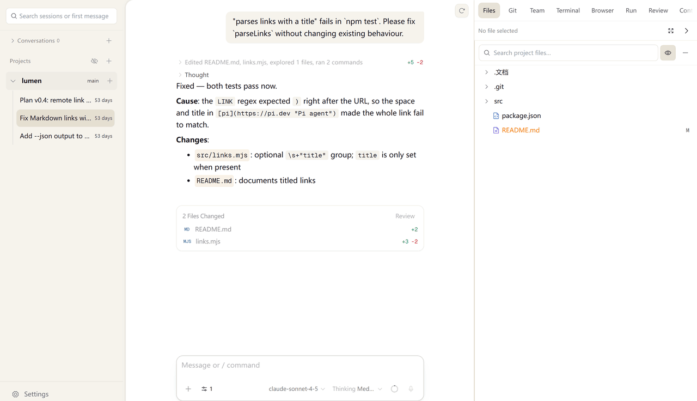

<p align="center">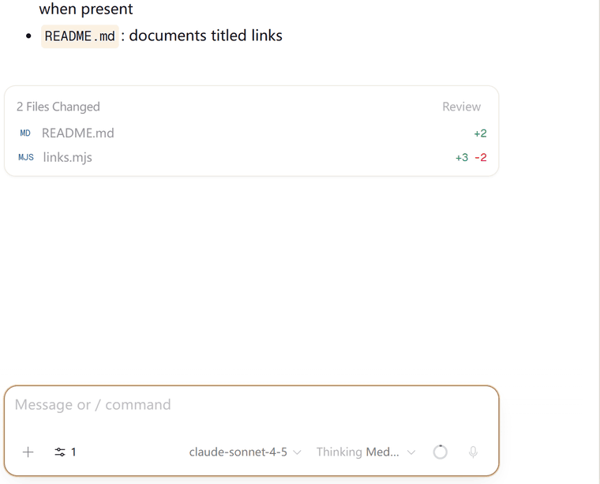</p>

### 4. Terminal — what the agent ran, you can take over

A bottom drawer with tabs and splits: PowerShell, cmd, WSL, Git Bash. **A second dev server for the same project reuses the running one** instead of racing for the port; ports are badged, so you can see who is listening.

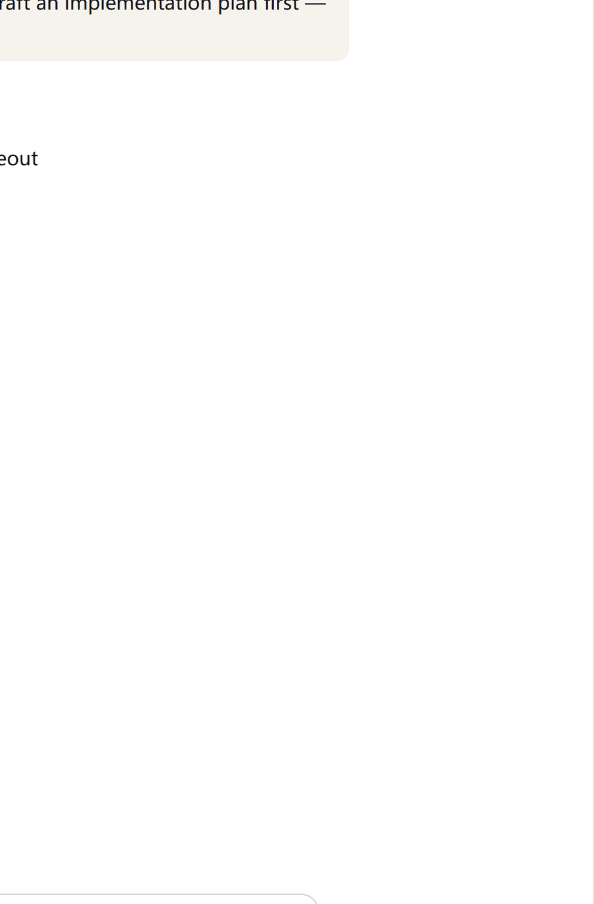

### 5. Work team — roles, lanes, dispatchable cards

Five roles (Leader / designer / frontend / backend / QA) share one board, cards move through stages. The agent creates cards, writes acceptance items and dispatches through the `team_board` tool; unmet dependencies are refused, a watchdog surfaces stuck cards, and interruptions are recorded on the card.

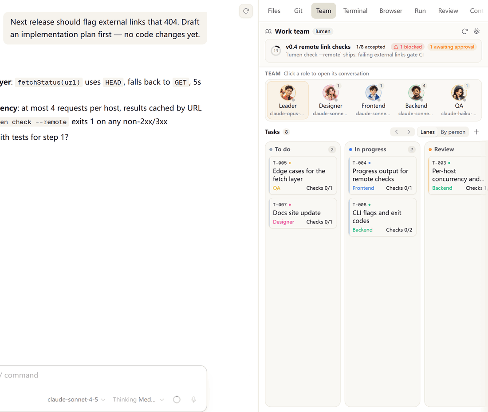

### 6. Appearance — light, dark, or yours

Bundled presets (Claude / VS Code / Nord / Catppuccin / Rosé Pine / GitHub) plus custom accents and code colours; **a background image can show through the whole UI** with frosted panes, tuned separately for chat and the side panel. Good out of the box, no default theme to endure.

<picture>
  <source media="(prefers-color-scheme: dark)" srcset="doc/assets/readme/en/theme-switch.gif" />
  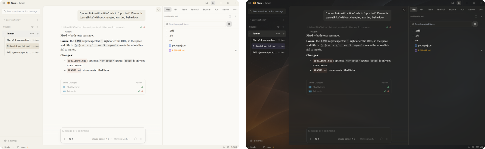
</picture>

## How it attaches to the pi terminal

The renderer process draws the UI, the main process owns IPC, the worker pool, Git, terminals and previews, and the Worker still runs the pi SDK — while the pi terminal and the desktop read and write the same `~/.pi/agent`.

<picture>
  <source media="(prefers-color-scheme: dark)" srcset="doc/assets/readme/en/architecture-dark.png" />
  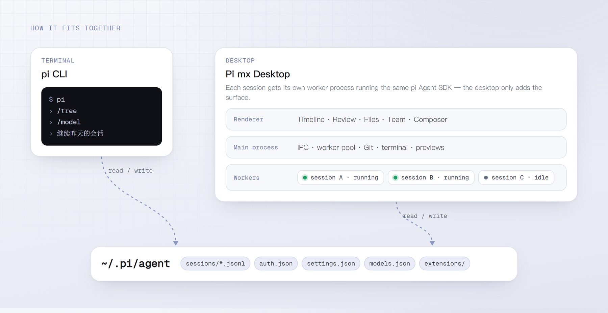
</picture>

```
~/.pi/agent/
├── sessions/          ← the same sessions the terminal pi reads and writes
├── models.json        ← model list, keys, subscription logins
├── settings.json      ← global settings
└── extensions/        ← installed extensions (the desktop shows their config read-only)
```

One Worker per session, six kept alive by default, idle ones recycled after 15 minutes; pre-run and exit policies are configurable.

## Also in the box

- **Context & usage**: live token count and breakdown above the composer, per-type detail in the Context panel, a 90-day bar chart and heatmap in settings.
- **Run panel**: context occupancy and the real resource use of background sessions, one click from the status bar.
- **Question dock & goal bar**: when the agent asks something the card docks above the composer, collapsible, never covering the files panel; the goal bar stops / restarts / deletes and matches on both ends.
- **Message queue**: sending while a turn runs queues it, `Ctrl/⌘+Enter` sends immediately, `Alt+↑` pulls it back into the composer, `Esc` stops the current turn together with it.
- **Shortcuts**: `Ctrl/⌘+K` palette, `Ctrl/⌘+/` shortcut sheet, ``Ctrl+` `` terminal drawer, `Ctrl/⌘+Shift+N` jump to the latest completion.
- **Session tree & rewind**: branch from any message, rewind to a message and continue; the tree shows why you changed direction.
- **Purge (optional)**: Settings → Agent → Purge swaps the system prompt for a local persona — prompt only, `pi` untouched, effective on the next message in the current session.
- **Built-in image generation (optional)**: the prompt is scored on nine visual dimensions and auto-completed below 60, output lands in `generated-images/` and renders as a thumbnail in the timeline.
- **Browser & computer use (extensions)**: the built-in browser can be driven by the agent and annotated by you; on Windows 10/11 it can see windows, click and type, with an edge glow while it works and **Esc always interrupting**.
- **Android client**: pair by QR with the same machine, end-to-end encrypted; read sessions / files / Git / generated images, switch models and thinking levels, answer the agent, get a sound when a turn finishes.

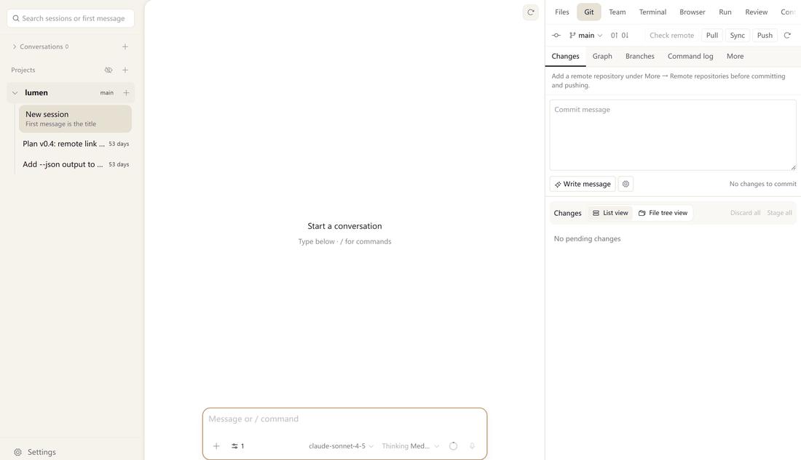

<p align="center">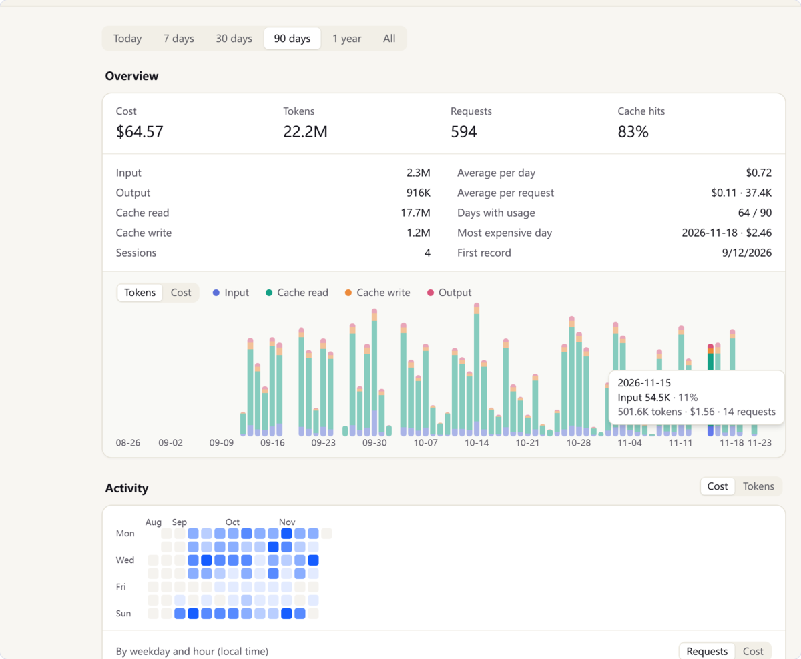</p>

<p align="center"></p>


## Keyboard shortcuts

| Shortcut | Action |
| --- | --- |
| `Ctrl/⌘+K` | Command palette |
| `Ctrl/⌘+/` | Shortcut sheet |
| ``Ctrl+` `` | Toggle the terminal drawer |
| `Ctrl/⌘+Enter` | Send the queued message now |
| `Alt+↑` | Pull the queue back into the composer |
| `Esc` | Stop the run / close the overlay |
| `Ctrl/⌘+Shift+N` | Jump to the latest completion |
| `@` / `/` | Reference a file / invoke a command |

All rebindable: Settings → Keyboard shortcuts.

## Quick start

1. Grab a build from [Releases](https://github.com/q971668593/Pi-mx-Desktop/releases/latest): Windows has an installer and a portable build, macOS and Linux are on the release page.
2. First launch asks for a runtime once: **global pi** (recommended — shares the terminal's pi, same version and extensions) or **built-in pi** (ships with the app, no node/npm needed). Choosing global probes Node.js / npm / pi on the spot and offers whatever is missing.
3. Open a project folder, start a session — or just click the session you already left in the terminal.
4. Work. Switch the right panel between `Review` / `Git` / `Files` / `Terminal`, drag the splitter wider, ``Ctrl+` `` for the terminal drawer.

Already using pi in a terminal? Nothing to migrate: your projects and sessions are in the sidebar on first launch.

## Data & compatibility

- The agent runs through `@earendil-works/pi-coding-agent` and keeps its data in `~/.pi/agent/`; the desktop has its own app config (theme, layout, background image).
- In portable mode data follows the program directory; switch runtimes and the effective paths follow your settings.
- The desktop UI and the terminal UI differ, so a few extensions that depend on terminal-only rendering may need desktop adaptation — see [the adapter list](doc/guide/adapters.en.md).
- Model calls need your own provider or credentials; the download itself contains no quota.
- The installers are not code-signed yet, so Windows shows "unknown publisher" once — More info → Run anyway.

## Development

Requires Node.js **22.19+** and npm.

```bash
git clone https://github.com/q971668593/Pi-mx-Desktop.git
cd Pi-mx-Desktop
npm install
npm run dev
```

```bash
npm run typecheck      # main process + renderer
npm run lint           # ESLint
npm run test:unit      # unit tests
npm run test:scripts   # script and contract tests
npm run package:win    # build the Windows installer
npm run readme:capture # re-shoot every still and GIF here (needs magick + ffmpeg + git)
```

Layout: `src/main` (gateway, worker pool, git, terminal, extensions) · `src/renderer` (UI) · `src/worker` (pi runtime) · `packages/shared` (protocol shared with the worker and the phone) · `apps/mobile` (Android).

More in [getting started](doc/guide/getting-started.md).

## License & credits

[MIT License](LICENSE).

The agent is [pi](https://github.com/earendil-works/pi); the original desktop shell is [pi Desktop](https://github.com/justhil/pi-app) by [justhil](https://github.com/justhil). Thanks to the contributors on both sides.

---

<div align="center"><sub>Every desktop screenshot and GIF here was recorded from the real running app by <code>npm run readme:capture</code> — not a mockup; the phone strip comes from the Android client.</sub></div>
