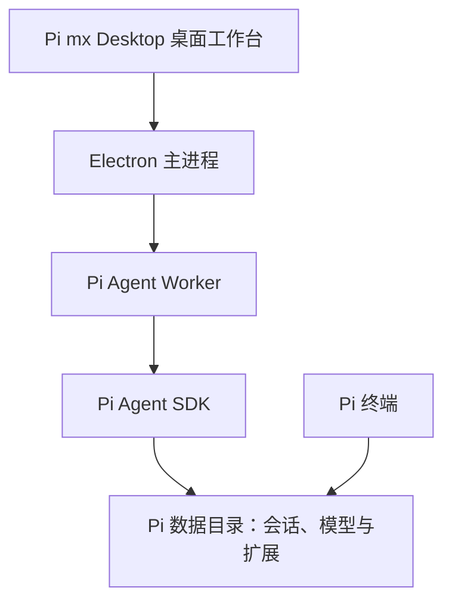

<div align="center">


# Pi mx Desktop

### 把 Pi 的强大，带到桌面。

**基于 Pi 的桌面工作台：熟悉的 Agent 与终端生态，更直观的开发体验。**

一个窗口，管理项目、对话、代码、Git、终端和浏览器。<br />
继续使用你熟悉的 Pi，让桌面为你的开发工作加速。

[下载 Pi mx Desktop](https://github.com/q971668593/Pi-mx-Desktop/releases/latest) · [快速开始](#快速开始) · [功能介绍](#一个工作台完成更多开发工作) · [English](README.en.md)

[](https://github.com/q971668593/Pi-mx-Desktop/releases/latest)
[](https://github.com/q971668593/Pi-mx-Desktop/releases)
[](LICENSE)

</div>

## 什么是 Pi mx Desktop？

[Pi](https://github.com/earendil-works/pi) 是一款可扩展的终端 AI 编程 Agent。Pi mx Desktop 基于 Pi 的 Agent SDK 构建，在熟悉的 Pi 能力之上提供桌面界面与开发工具。

**你的 Pi 还是你的 Pi。** 应用沿用 Pi 的会话和配置，扩展、模型等沿用 Pi 的生态；桌面工作台则让你更方便地查看过程、管理项目、审查代码和运行应用。你仍然可以使用终端版 Pi，不必为了换界面重新开始。

> Pi mx Desktop 不是 Pi 官方产品，源自 [pi Desktop](https://github.com/justhil/pi-app)，感谢 Pi 和原项目的贡献者。

### 为什么选择 Pi mx Desktop？

| 保留 Pi 的使用习惯 | 获得桌面工作台的便利 |
| --- | --- |
| 基于 Pi Agent SDK，继续使用 Pi 的工具与运行机制 | 对话、文件、Git、终端和浏览器集中在一个窗口 |
| 与终端版共用 `~/.pi/agent` 下的会话和配置 | 多项目、多会话切换，工作进度更清晰 |
| 沿用 Pi 模型配置及扩展生态 | 可视化查看代码变更、运行过程和上下文 |
| 保留终端使用方式，按任务选择合适入口 | 支持插件、技能、MCP 等能力的管理入口 |

桌面界面与终端交互方式不同，部分依赖终端专属界面的扩展可能需要桌面适配；具体支持情况请参考 [扩展适配列表](doc/guide/adapters.zh-CN.md)。

## Pi 与桌面工作台如何配合



桌面通过 Pi Agent SDK 执行任务；Pi 终端和桌面默认使用同一份 Pi 数据。桌面工作台提供可视化操作入口，具体数据目录可能因运行时或便携模式而不同。

## 一个工作台，完成更多开发工作

### 💬 从对话到交付，看清 Agent 的每一步

在对话中查看思考、工具调用和执行结果；需要补充要求时继续追问。支持会话管理、历史查看和分支，让长期任务不再淹没在终端输出中。

### 📁 多项目、多会话，各自保持上下文

在同一个桌面工作台中管理多个项目，为不同任务建立独立会话。切换项目和会话时，可以继续查看对应的文件与工作状态。

### 🔍 代码审查和 Git，不用来回切窗口

查看文件变更和差异，按需审查代码；通过 Git 面板处理分支、提交及同步等日常操作。让 Agent 写代码，也让你更容易掌握它改了什么。

### 🖥️ 文件、终端、浏览器，开发现场就在手边

浏览和编辑项目文件，打开终端运行命令，使用内置浏览器查看页面。写代码、启动项目、检查效果，可以在同一个工作区完成。

### 🧩 继续使用 Pi 生态

使用已有的 Pi 模型配置和扩展，并通过桌面设置管理模型、扩展、Skills、MCP 等。扩展是否完整支持取决于其实现方式和桌面适配情况。

### 🤝 让复杂任务更容易推进

通过目标、任务和团队看板整理工作进度，结合 Pi 的扩展能力进行协作。对于需要多步骤完成的开发任务，可以更直观地查看和跟进。

### 📱 离开电脑，也能关注进度

通过配套 Android 客户端连接桌面，查看会话、文件和 Git 等信息，在不方便坐在电脑前时继续跟进任务。移动端依赖桌面端运行，具体功能以当前版本为准。

## 快速开始

1. 前往 [Releases](https://github.com/q971668593/Pi-mx-Desktop/releases/latest)，下载适合自己设备的版本。Windows 提供安装版和便携版，具体文件以发布页面为准。
2. 启动应用并按提示选择 Pi 运行时，配置模型或登录已有模型服务。
3. 打开一个项目文件夹，新建或选择会话，输入你的开发需求。
4. 在工作台中查看 Agent 执行过程，按需使用文件、Git、终端和浏览器面板。

已经在终端使用 Pi？桌面端使用同一套 Pi 数据目录。建议先确认运行时与现有配置，扩展的界面兼容情况可查看 [扩展适配列表](doc/guide/adapters.zh-CN.md)。

## 数据与兼容性

Pi mx Desktop 通过 `@earendil-works/pi-coding-agent` 运行 Agent。默认情况下，Pi 的数据保存在 `~/.pi/agent/`，其中包括会话、模型配置和扩展等；桌面端也有自己的应用配置。切换运行时或使用便携模式时，实际路径和可用能力以应用设置为准。

模型调用通常需要配置服务商或已有凭据；下载桌面端本身不包含模型额度。部分扩展、浏览器能力及移动端功能可能需要额外配置。

## 本地开发

环境要求：Node.js **22.19 或更新版本**，以及 npm。

```bash
git clone https://github.com/q971668593/Pi-mx-Desktop.git
cd Pi-mx-Desktop
npm install
npm run dev
```

常用命令：

```bash
npm run typecheck      # TypeScript 检查
npm run lint           # ESLint 检查
npm run test:unit      # 单元测试
npm run test:scripts   # 脚本和契约测试
npm run package:win    # 构建 Windows 安装包
```

更多使用说明见 [操作指南](doc/guide/getting-started.zh-CN.md)。

## 开源与致谢

本项目基于 [MIT License](LICENSE) 开源。感谢 [Pi](https://github.com/earendil-works/pi)、[pi Desktop](https://github.com/justhil/pi-app) 及其贡献者，让这个项目成为可能。
