<div align="center">


# Pi mx Desktop

### 终端里的 Pi 已经很强了。它缺的是一张桌子。

**把 Pi 的终端 Agent 搬进桌面工作台 —— 不改 Agent，只把过程摊开。**

同一个 `pi`、同一份 `~/.pi/agent`、同一套扩展和模型配置。<br />
多出来的是一整块屏幕：时间线、并排 diff、文件树、真终端、团队看板、主题壁纸。

[](https://github.com/q971668593/Pi-mx-Desktop/releases/latest)
[](https://github.com/q971668593/Pi-mx-Desktop/releases)


[](LICENSE)

[下载](https://github.com/q971668593/Pi-mx-Desktop/releases/latest) · [上手指南](doc/guide/getting-started.zh-CN.md) · [适配器列表](doc/guide/adapters.zh-CN.md) · [English](README.en.md)

<sub>基于 [pi Desktop](https://github.com/justhil/pi-app)（作者 [justhil](https://github.com/justhil)）开发，MIT 许可。不是 Pi 官方产品。</sub>

</div>

<picture>
  <source media="(prefers-color-scheme: dark)" srcset="doc/assets/readme/zh/hero-dark.png" />
  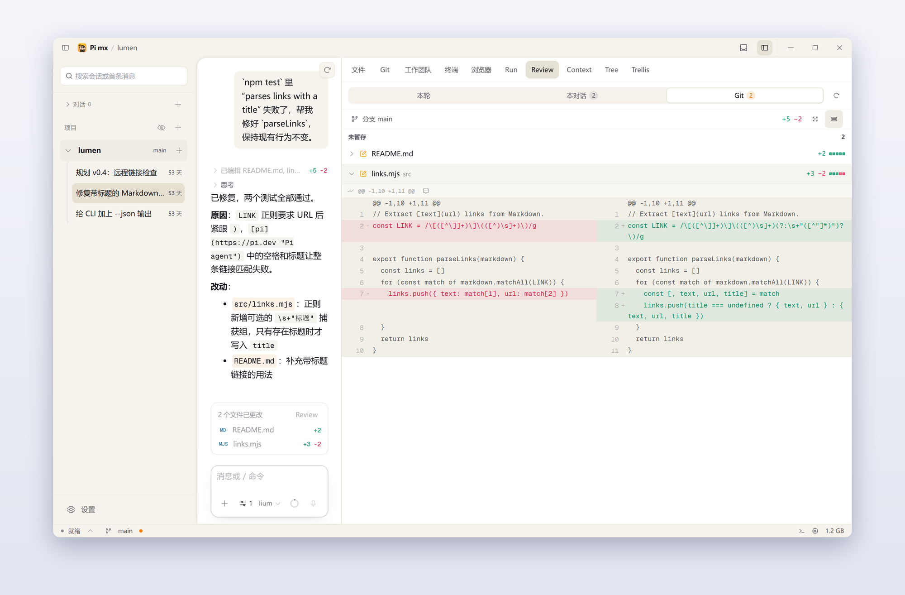
</picture>

## 先说清楚：它没有改掉你的终端

这是最容易误会的一点，所以放在最前面。

| | 终端里的 `pi` | Pi mx Desktop |
| --- | --- | --- |
| Agent 本体 | `@earendil-works/pi-coding-agent` | **完全同一个**，跑在后台 Worker 里 |
| 会话数据 | `~/.pi/agent/sessions/*.jsonl` | **读写的还是这些文件**，没有自己的数据库 |
| 模型与密钥 | `~/.pi/agent/models.json` | **同一份**，终端里配的模型桌面里直接能用 |
| 设置与扩展 | `~/.pi/agent/settings.json`、`extensions/` | **同一份**，装过的扩展照样加载 |
| 工具与运行机制 | 内置工具、MCP、技能 | **一整套保留**，不重写、不替换 |
| 能不能继续用终端 | — | **能**，两边随时接力同一个会话 |

**没有 patch `pi`，没有改 `node_modules`，没有另造一个 Agent 内核。** 桌面端做的事只有一件：把 Agent 在终端里只能一行行滚过去的东西，排到一块能同时看清的屏幕上。

> 写脚本、跑 CI、`git bisect` —— 还是终端顺手。这里解决的是另一段：**Agent 干活的时候，人要看、要判断、要插话。**

## 一块屏幕，看清五件事

终端 Agent 一跑十分钟，你就开始翻屏：改了哪几个文件？哪个 hunk 该留？3000 端口是谁占的？昨天那个会话聊到哪了？上下文还剩多少？

这五个问题，桌面端一个窗口同时回答：

| 你想知道 | 终端里 | Pi mx Desktop |
| --- | --- | --- |
| Agent 刚做了什么 | 一行行往上翻 | **时间线**：思考 / 命令 / 读 / 改逐条成步骤，正文一开始就折成一行摘要 |
| 到底改了哪几行 | `git diff` 再滚屏 | **Review 面板**：逐 hunk 暂存，并排 diff，可对某几行写批注 |
| 项目里有什么 | `ls` / `cat` | **文件面板**：树 + 搜索 + 带 revision 守卫的预览与编辑 |
| 命令谁占着端口 | `netstat` 猜 | **真终端**：多标签、可分屏、端口徽标，同一项目不会起两个 dev server |
| 会话花在哪 | 心里估 | **Context 面板**：用户 / 助手 / 各种工具各占多少、余量还剩多少 |

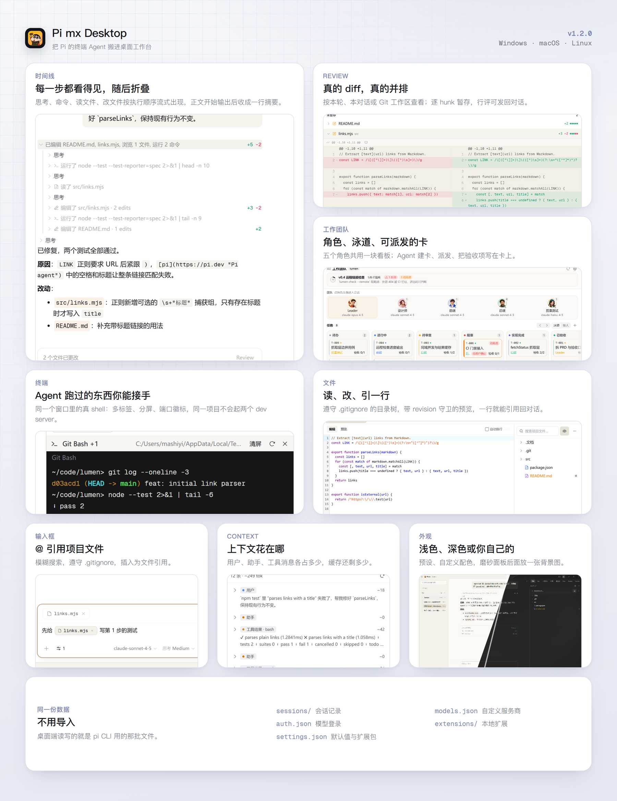

## 六件让人回不去的事

### 一、时间线：每一步都看得见，随后折叠

思考、命令、读文件、改文件按顺序流式出现，正文开始输出后就收成一行 `已编辑 README.md, links.mjs, 浏览 1 文件, 运行 2 命令 +5 −2`。想看过程点开，不想看它就让路。

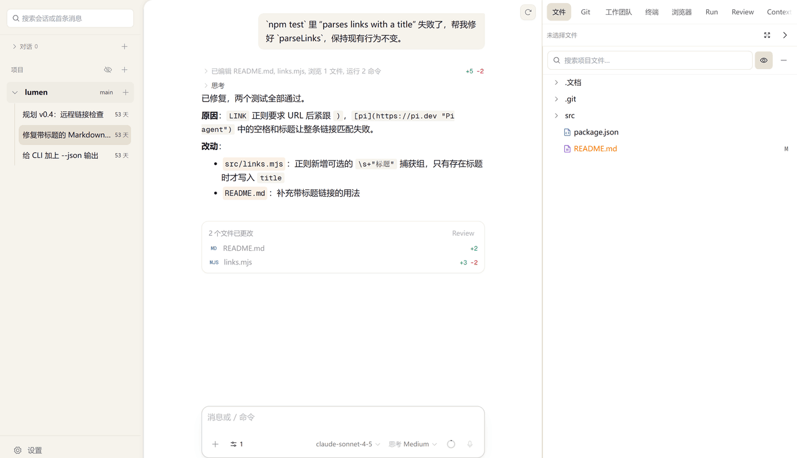

- 思考链、Markdown、代码块、KaTeX 原位渲染；长输出默认收着。
- 每次编辑标 `+N −M`，回合结束给一张「文件已更改」卡片，点开就在 Review 或文件面板里。
- 失败不是一行红字：**分类原因（超时 / 连不上 / 额度 / 鉴权 / 上下文过长 / HTTP 状态码）+ 原始错误可展开、可复制**。
- 悬停任意消息：复制 / 回退到此处 / 从这里 fork 一个新会话。

### 二、Review：真的 diff，真的并排

拉宽右侧栏，切到 Review 的 Git 工作区，逐个文件看，或者按 hunk 暂存；长按几行写批注，批注会随下一条消息一起送给 Agent ——「这里为什么这么改」不用再复述一遍。

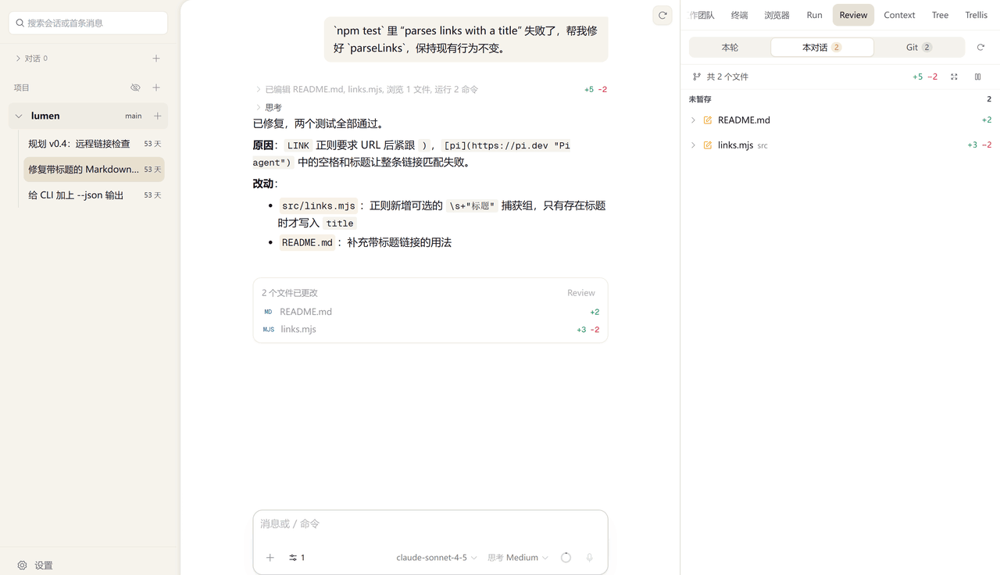

头部就有 **拉取 / 同步 / 推送**，`↑` 红 `↓` 绿；分支切换、提交说明生成、冲突取舍各有界面。

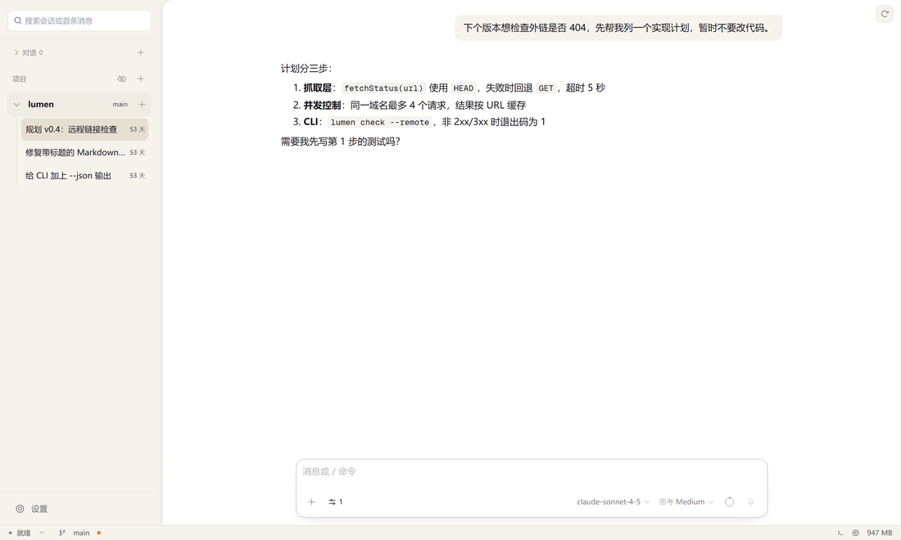

### 三、文件：读、改、引一行

树 + 搜索，遵守 `.gitignore`；预览带 revision 守卫（别处改过就拒绝覆盖，而不是踩掉）。把文件夹直接拖进输入框，落成 `@路径` 引用；在输入框打 `@` 立刻弹候选，选完变成文件 chip。


<p align="center">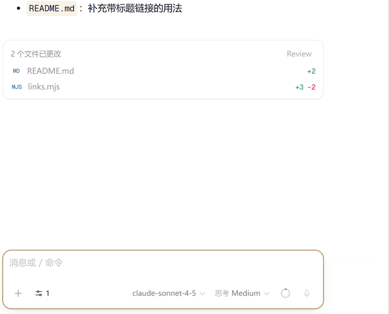</p>

### 四、终端：Agent 跑过的东西你能接手

底部终端抽屉，多标签、可分屏，PowerShell / cmd / WSL / Git Bash 都能开。**同一项目不会并排起两个开发服务器** —— 重复启动会复用已经在跑的那个，端口不打架；占用的端口有徽标，点一下就知道谁在听。


### 五、工作团队：角色、泳道、可派发的卡

五个角色（Leader / 设计师 / 前端 / 后端 / 质量测试）共用一块看板，卡片按阶段推进。Agent 通过 `team_board` 工具建卡、写验收项、派发；前置依赖没验收会拦住，看门狗盯着卡住的卡，插话和中止都记在卡上。

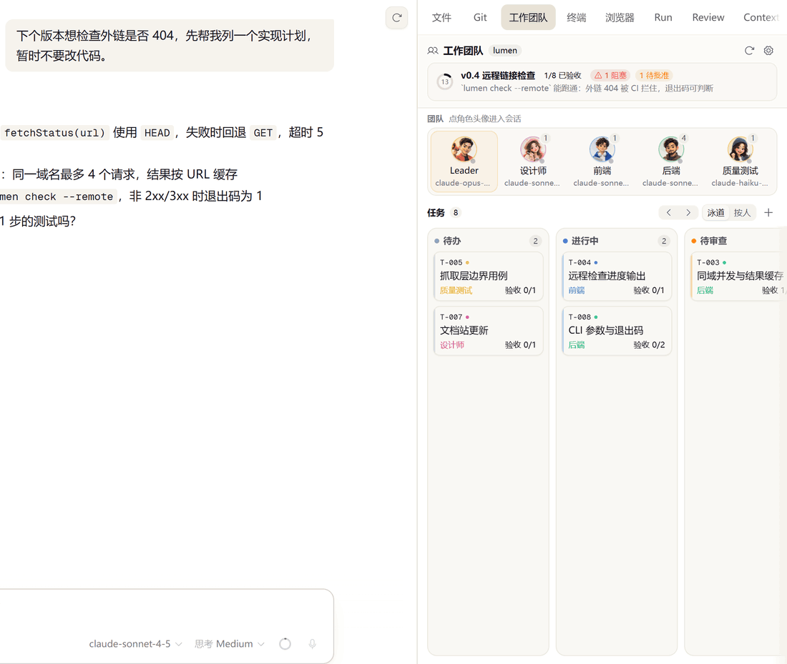

### 六、外观：浅色、深色，或你自己的

内置 Claude / VS Code / Nord / Catppuccin / Rosé Pine / GitHub 等预设，也能自定义强调色与代码配色；**背景图能透出整个界面**，面板走磨砂，聊天区与右侧栏可以单独调。第一次跑起来就顺手，不用忍着默认主题。

<picture>
  <source media="(prefers-color-scheme: dark)" srcset="doc/assets/readme/zh/theme-switch.gif" />
  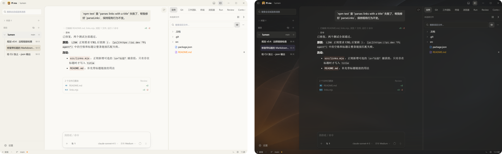
</picture>

## 它和 pi 终端是怎么接上的

桌面端不改 Agent，只是给同一个 Agent 多加了一层壳：渲染进程画界面，主进程管 IPC、Worker 池、Git、终端和预览，Worker 里跑的仍然是 pi SDK —— 而 Pi 终端和桌面端读写的是同一份 `~/.pi/agent`。

<picture>
  <source media="(prefers-color-scheme: dark)" srcset="doc/assets/readme/zh/architecture-dark.png" />
  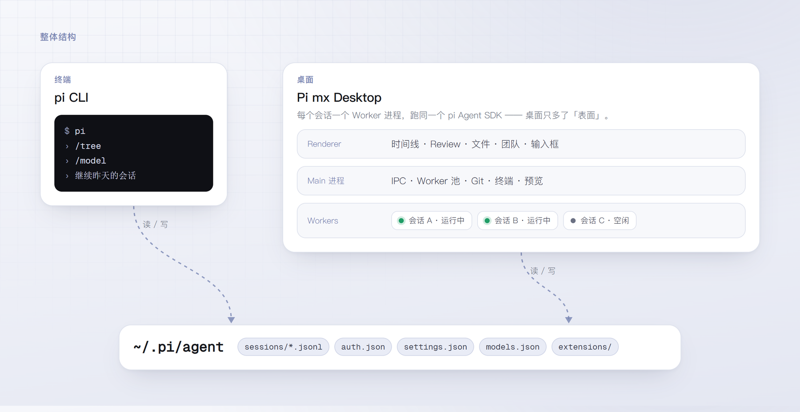
</picture>

```
~/.pi/agent/
├── sessions/          ← 终端 pi 和桌面端读写同一批会话
├── models.json        ← 模型列表、密钥、订阅登录
├── settings.json      ← 全局设置
└── extensions/        ← 已安装扩展（桌面端只读展示其配置）
```

一个会话一个 Worker，默认同时保留 6 个、空闲 15 分钟回收；预跑与退出策略可以在设置里调。

## 还有这些

- **上下文与用量**：输入框上方实时显示 token 与占比，Context 面板按用户 / 助手 / 各类工具结果分项，设置里还有 90 天用量柱状图与热力图。
- **运行与资源**：Run 面板把上下文占用与后台会话的实时资源摆在一起，点状态栏就能看。
- **问答坞与目标条**：Agent 反问你时问题卡贴在输入框上方、可折叠，不挡右侧文件面板；目标条能终止 / 再启动 / 删除，两端一致。
- **排队消息**：运行中发送等于排队，`Ctrl/⌘+Enter` 立即发送，`Alt+↑` 拉回输入框，`Esc` 连同当前这一轮一起停下。
- **快捷键**：`Ctrl/⌘+K` 命令面板、`Ctrl/⌘+/` 快捷键列表、``Ctrl+` `` 终端抽屉、`Ctrl/⌘+Shift+N` 跳进最新完成通知。
- **会话树与回退**：从任意一条消息开子分支，回退到某条消息继续；树上看清「当时为什么换方向」。
- **破甲（可选）**：设置 → Agent → 破甲，把系统提示词换成本地人设，只换提示词、不 patch pi，当前会话下一句话就生效。
- **内置生图（可选）**：提示词先按九维体检、低于 60 分自动补齐再出图，结果落进 `generated-images/`，时间线直接出缩略图。
- **浏览器与电脑操作（扩展能力）**：内置浏览器可被 Agent 驱动，页面上能画框批注；Windows 10/11 上能看窗口、点、打字，执行时屏幕边缘有一圈呼吸灯，**Esc 随时打断**。
- **手机端**：Android 连同一台电脑，扫码配对、端到端加密，看会话 / 文件 / Git / 生图，切模型与思考强度，回答 Agent 的提问，跑完响一声。

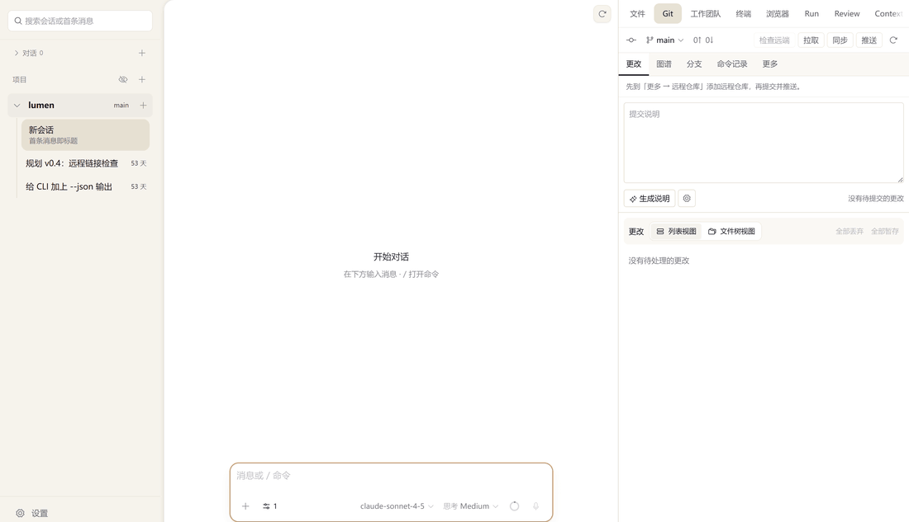

<p align="center">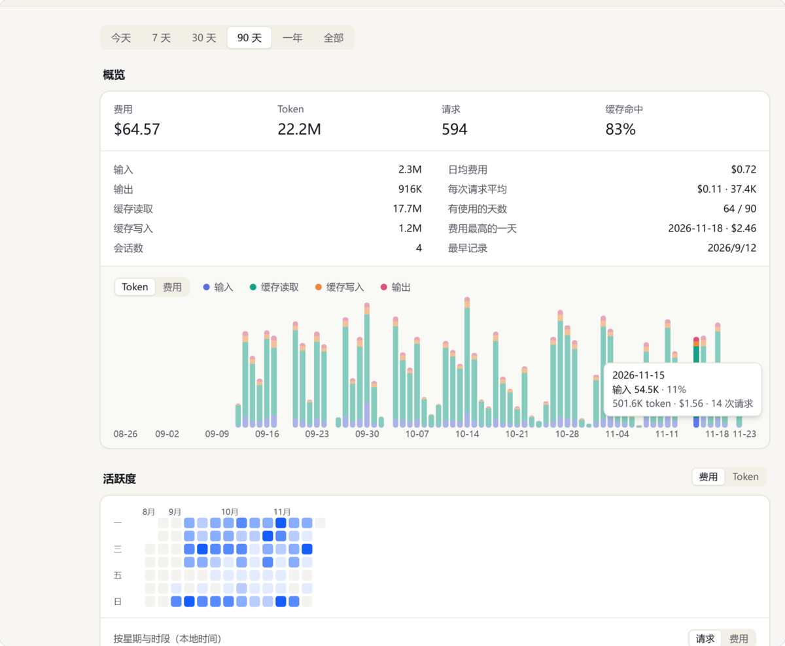</p>

<p align="center"></p>


## 键盘快捷键

| 快捷键 | 作用 |
| --- | --- |
| `Ctrl/⌘+K` | 打开命令面板 |
| `Ctrl/⌘+/` | 显示快捷键列表 |
| ``Ctrl+` `` | 开关终端抽屉 |
| `Ctrl/⌘+Enter` | 立即发送排队消息 |
| `Alt+↑` | 把排队消息拉回输入框 |
| `Esc` | 停止运行 / 关闭浮层 |
| `Ctrl/⌘+Shift+N` | 进入最新完成通知 |
| `@` / `/` | 引用文件 / 调用命令 |

支持自定义：设置 → 键盘快捷键，按一下即可重绑。

## 快速开始

1. 到 [Releases](https://github.com/q971668593/Pi-mx-Desktop/releases/latest) 下载：Windows 有安装版与便携版，macOS / Linux 见发布页。
2. 首次启动会问一次运行时：**全局 pi**（推荐，和终端那份共用，版本与扩展一致）或**内置 pi**（随应用自带，不用 node/npm）。选全局会当场体检 Node.js / npm / pi 三项，缺什么给什么入口。
3. 打开一个项目文件夹，新建会话或直接点开终端里留下的那个会话。
4. 该做什么就做什么 —— 右侧栏按 `Review` / `Git` / `文件` / `终端` 随时切换，拖分隔条拉宽，``Ctrl+` `` 叫出终端抽屉。

已经在终端用 Pi？什么都不用迁移：启动后侧栏里就是你原来的项目与会话。

## 数据与兼容性

- Agent 通过 `@earendil-works/pi-coding-agent` 运行，数据默认在 `~/.pi/agent/`；桌面端另有自己的应用配置（主题、布局、背景图）。
- 便携模式下数据跟着程序目录走，切换运行时实际路径以应用设置为准。
- 桌面界面与终端界面形态不同，少数依赖终端专属渲染的扩展可能需要桌面适配，见 [扩展适配列表](doc/guide/adapters.zh-CN.md)。
- 模型调用需要你自己的服务商或凭据，下载桌面端本身不含模型额度。
- 安装包目前没有代码签名证书，Windows 会提示「未知发布者」，点「更多信息 → 仍要运行」即可。

## 本地开发

环境：Node.js **22.19+** 与 npm。

```bash
git clone https://github.com/q971668593/Pi-mx-Desktop.git
cd Pi-mx-Desktop
npm install
npm run dev
```

```bash
npm run typecheck      # 主进程 + 界面
npm run lint           # ESLint
npm run test:unit      # 单元测试
npm run test:scripts   # 脚本与契约测试
npm run package:win    # 打 Windows 安装包
npm run readme:capture # 重拍本文所有截图与动图（需 magick + ffmpeg + git）
```

目录：`src/main` 主进程（网关、Worker 池、Git、终端、扩展）· `src/renderer` 界面 · `src/worker` pi Worker 运行时 · `packages/shared` 与 Worker / 手机共用的协议 · `apps/mobile` Android 客户端。

更多说明见 [操作指南](doc/guide/getting-started.zh-CN.md)。

## 开源与致谢

[MIT License](LICENSE) 开源。

Agent 本体是 [Pi](https://github.com/earendil-works/pi)；上游桌面壳来自 [pi Desktop](https://github.com/justhil/pi-app)（作者 [justhil](https://github.com/justhil)）。感谢两边的贡献者，让这件事成立。

---

<div align="center"><sub>本文所有桌面截图与动图都由 <code>npm run readme:capture</code> 从真实运行的界面录制，不是设计稿；手机端一张来自 Android 客户端。</sub></div>
