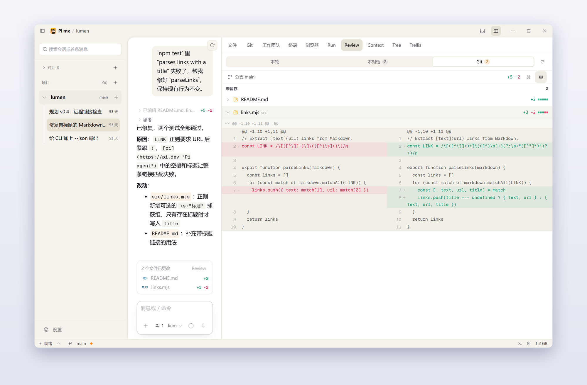
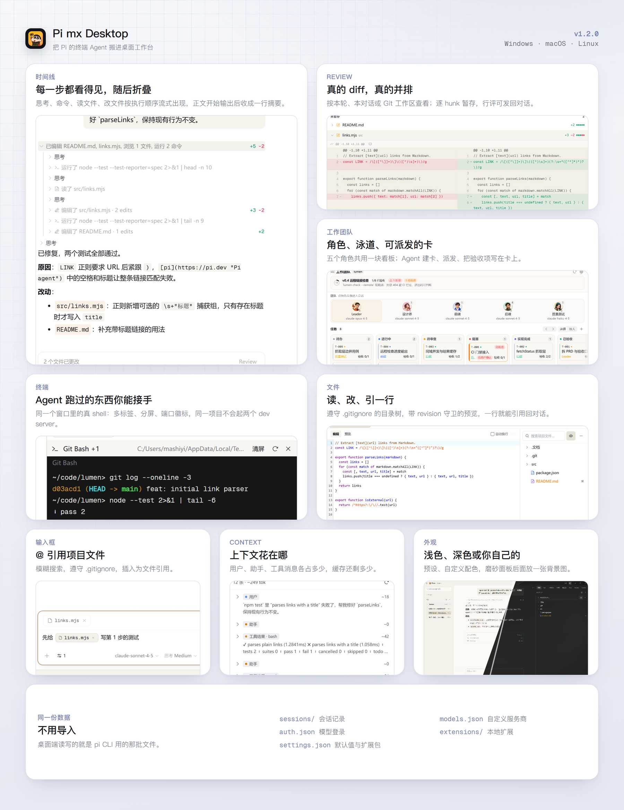
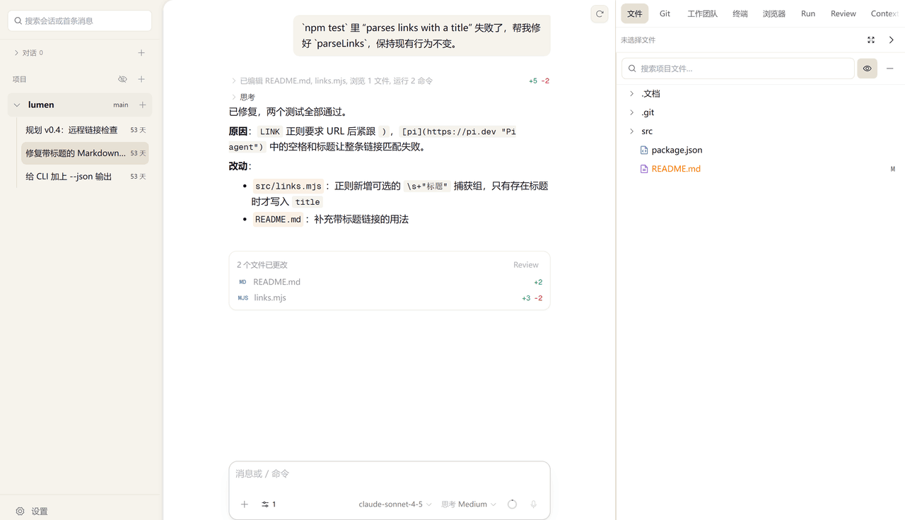
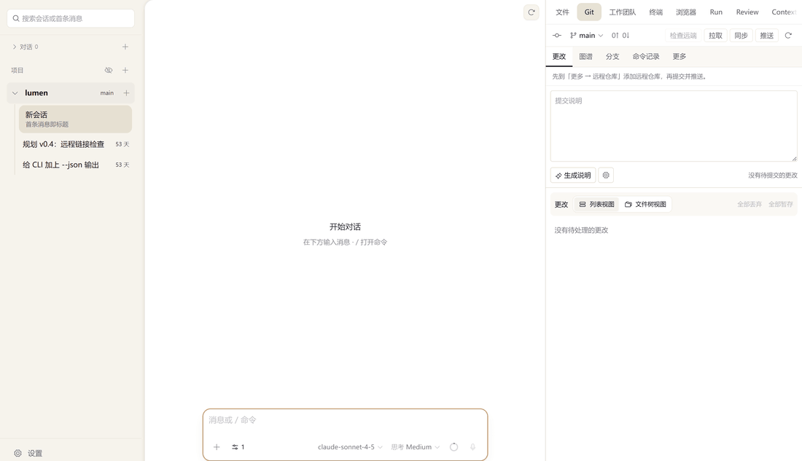
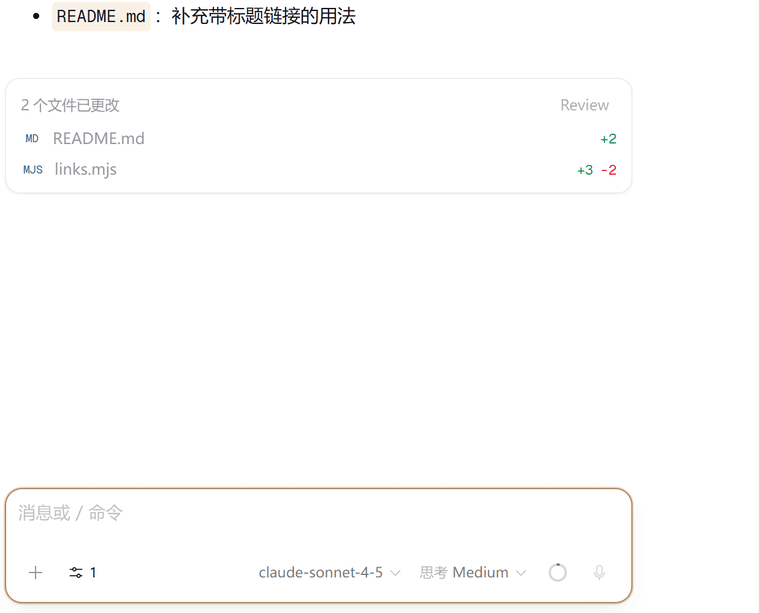
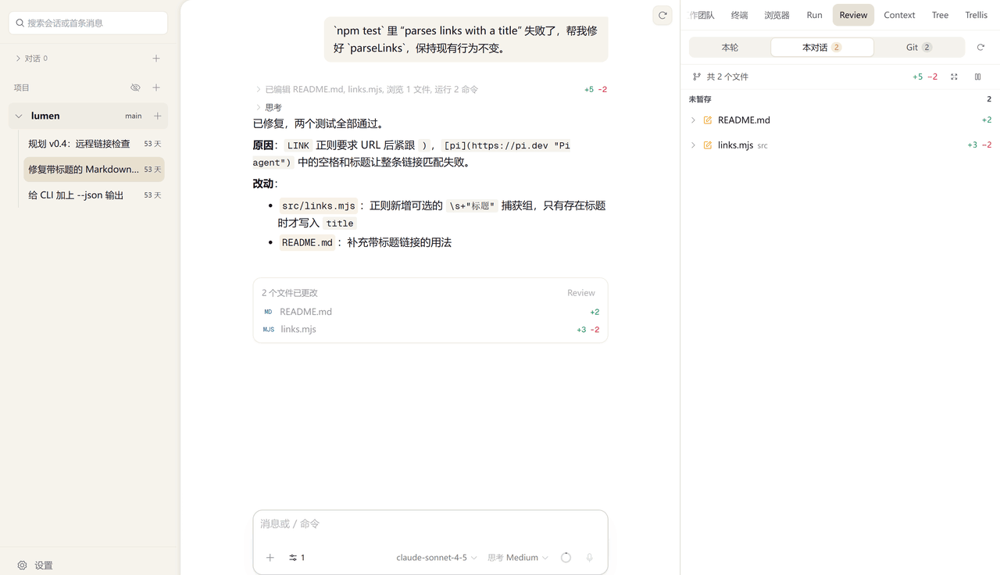
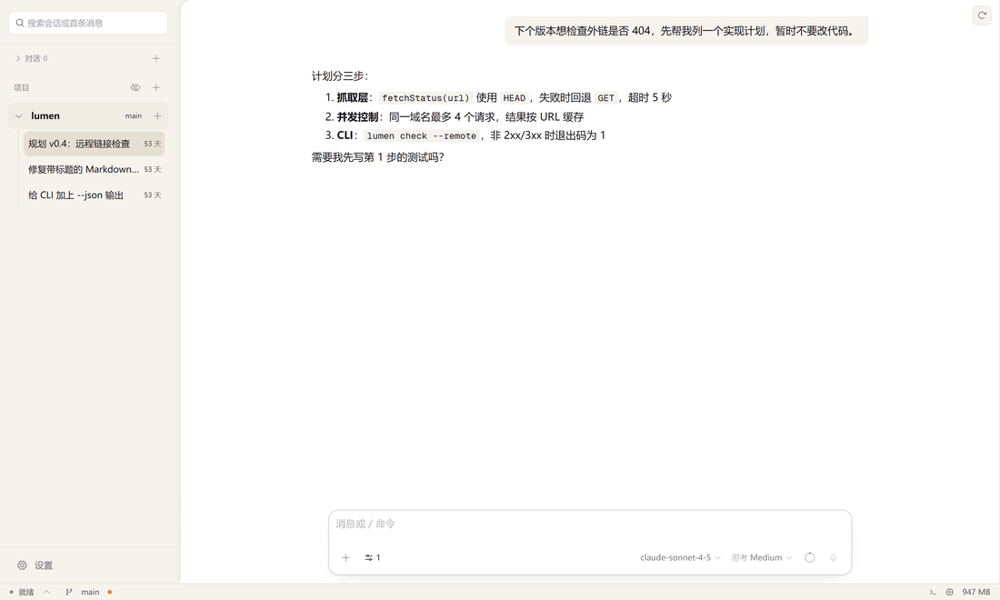
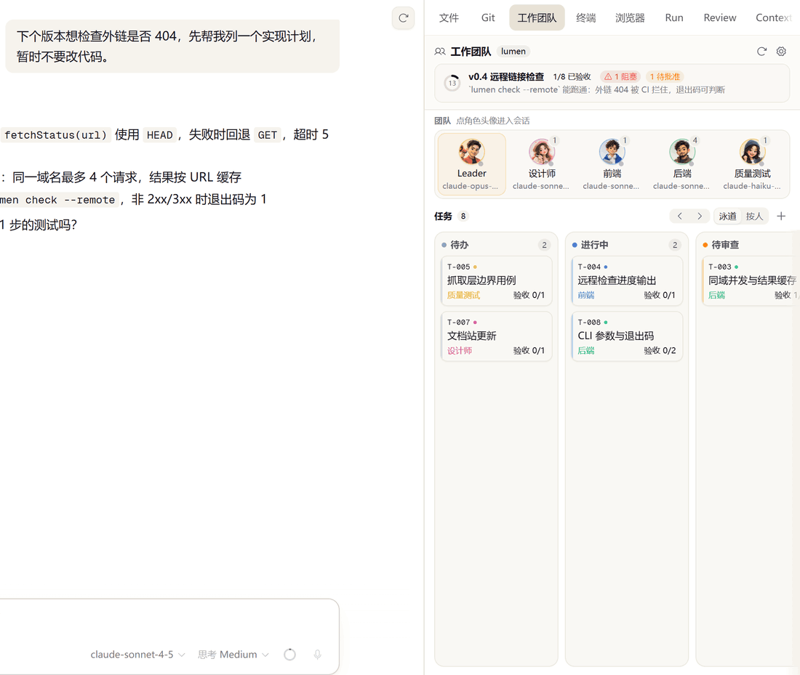
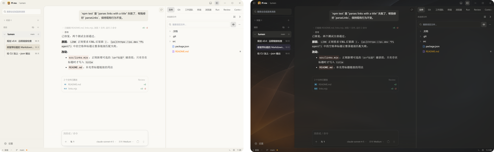
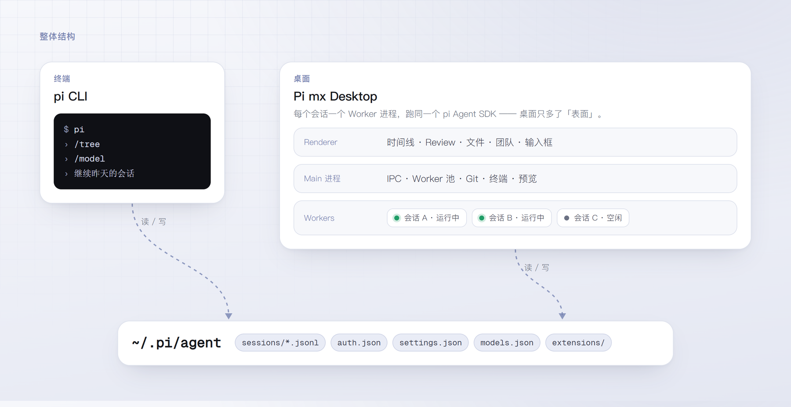

<div align="center">


# Pi mx Desktop · 深入版

**给终端里的 [pi](https://github.com/earendil-works/pi) Agent 加一张桌子 —— 不加第二个 Agent。**

同一份 `~/.pi/agent`，同一套 `models.json`、`settings.json` 和 `extensions/`；同一个 Worker 里跑的还是 `@earendil-works/pi-coding-agent`。<br />
门面介绍看 [README.md](./README.md)，这里把每一块能力、每一个取舍都摊开写。

[](https://github.com/q971668593/Pi-mx-Desktop/releases/latest)
[](https://github.com/q971668593/Pi-mx-Desktop/releases)


[](LICENSE)

[English](./README.en.md) · **简体中文** · [下载](https://github.com/q971668593/Pi-mx-Desktop/releases/latest) · [上手指南](./doc/guide/getting-started.zh-CN.md) · [适配器列表](./doc/guide/adapters.zh-CN.md)

<sub>基于 [pi Desktop](https://github.com/justhil/pi-app)（作者 [justhil](https://github.com/justhil)）开发，MIT 许可。不是 Pi 官方产品。</sub>

</div>

<picture>
  <source media="(prefers-color-scheme: dark)" srcset="doc/assets/readme/zh/hero-dark.png" />
  
</picture>

<sub>截图取自真实运行界面。<code>npm run readme:capture</code> 可重拍本文全部桌面素材；手机端图为 Android 客户端。</sub>

## 一句话说清它和终端版 Agent 的区别

终端 Agent 擅长"一条命令把活干完"；只要活超过十分钟，你就要开始翻屏：改了几个文件？哪个 hunk 该留？刚才那条命令的端口是谁占的？这个会话昨天聊到哪了？

**Pi mx Desktop 把这几件事都摊在屏幕上，而且不改 Agent 本身。** Worker 里跑的是同一个 pi SDK，读写的是同一批文件。终端里聊过的会话，打开应用就在侧栏里，接着聊即可。

## 和同类工具比，它站在哪

| | Claude Code / Codex CLI | Zed / Cursor 这类编辑器 | **Pi mx Desktop** |
|---|---|---|---|
| 形态 | 终端 TUI | 以编辑器为中心 | **以 Agent 为中心的桌面工作台** |
| 会话与文件 | 存在 CLI 自己的目录 | 编辑器工程模型 | **和 CLI 共用 `~/.pi/agent`，两边随时接力** |
| 改动审查 | 大体量 diff 翻屏 | 编辑器 diff | **Review 面板：逐 hunk 暂存、长按几行写批注，批注进下一条消息** |
| 文件 / Git / 终端 | 敲命令 | 内建但分散 | **三件套同屏常驻，右侧栏顺序可拖** |
| 追问打断 | Ctrl+C 重来 | — | **输入框正上方的问答坞 + 目标条，能终止 / 再启动** |
| 手机接手 | 无 | 无 | **手机端连同一台电脑：看会话、改文件、看 Git、听声音提醒** |
| 系统提示词 | 固定在 CLI | 固定在厂商 | **破甲：换成本地人设，一个开关、下一句话生效** |
| 多人协作 | 单会话 | 单会话 | **工作团队看板：五角色拆卡、派发、看门狗** |

> 目标不是取代终端 —— 写脚本、跑 CI、`git bisect` 还是终端顺手。这里解决的是「Agent 干活时，人要看、要判断、要插话」的那一段。

## 功能总览



## 时间线：Agent 在干什么，一眼看完

工具调用按步骤平铺流式出现 —— 思考、命令、读文件、改文件；正文开始输出后折叠成一行摘要。每次编辑标 `+N −M`，回合结束给一张「文件已更改」卡片，点开就在 Review 或文件面板里。



- 思考链、Markdown、代码块、KaTeX 原位渲染；长输出默认收着，点开看全文。
- 悬停任意消息：复制 / 回退到此处 / 从这里 Fork 一个新会话。
- 失败不是一行红字：**分类原因（超时 / 连不上 / 额度 / 鉴权 / 上下文过长 / HTTP 状态码）+ 原始错误可展开、可复制**。
- 聊天里出现的图片（生图结果、截图）直接出缩略图，点开全屏。



## 破甲：把系统提示词换成你自己的

设置 → Agent → 破甲，一个开关，把 pi 的系统提示词换成本地人设（默认带你正在用的那份）。**只换提示词，不 patch pi、不改 `node_modules`**，扩展在 `before_agent_start` 前读一次 `config.json`，所以拨完开关，**当前会话的下一句话就生效**，不用重启。

| 模式 | 发出的提示词 | 代价 |
|---|---|---|
| `strict`（默认） | 人设 + 当前工作目录 | 宿主提示词整段丢弃，`AGENTS.md` / skills 列表也没了 |
| `replace` | 人设 + 宿主提示词（切掉身份句与文档段） | 工具规则保留；锚点对不上就退化成 `append`，不会切坏 |
| `append` | 人设 + 宿主提示词原样 | 最温和，效果也最弱 |

人设文件缺失或为空时**不接管** —— 宁可原样发，也不会把系统提示词发空。终端里的 `/purge on|off|status|mode` 改的是同一份配置，两边一致。

## 文件管理：不只是浏览

- 右侧文件面板常驻，树 + 搜索，双击预览、直接编辑保存（带 revision 守卫，别处改过就拒绝覆盖而不是踩掉）。
- **文件夹可以直接拖进输入框**，落成 `@路径` 引用；Agent 自己去列目录、读文件。
- 输入框打 `@` 立刻弹候选（走 `fd` 索引，遵守 `.gitignore`），选中即变成文件 chip。
- 时间线里出现的**文档路径、文件名、图片**都是可点的：点文档路径直接在右侧打开，图片可右键复制 / 另存 / 贴回对话。
- 聊天的图片、粘贴的截图、拖进来的文件统一进附件区，发送前可逐个移除、重试上传。
- 手机端同一套能力：浏览、看代码、看图、改一行、保存。


<p align="center"></p>

## Git 管理：从"看 diff"到"决定留下什么"



- **Review 面板**：按文件列改动，逐 hunk 暂存；长按几行写批注，批注自动进下一条消息 ——「这里为什么这么改」不用再复述。
- 头部就有 **拉取 / 同步 / 推送**，`↑` 红 `↓` 绿，有没有没推的提交一眼看出来。
- 分支切换（下图）、**从任意一条消息 Fork 新会话**、回退到某条消息继续，都在时间线里直接做。
- 提交看板：最近提交、标签、储藏、工作树；冲突有专门的取舍界面。
- 手机端：最近提交一眼看、单文件 diff 也能翻。



## 终端：Agent 跑的东西，你能接手

- 底部终端抽屉（``Ctrl+` ``），多标签、可分屏；PowerShell / cmd / WSL / Git Bash 都能开。
- **端口徽标**：命令里占用的端口标出来，点一下就知道谁在听。
- **同一项目不会再并排起两个开发服务器** —— 重复启动会复用已有那个，避免端口打架。
- 命令块可以整段复制，也可以直接在终端里接手接着敲。


## 浏览器与电脑操作（扩展能力）

- 内置浏览器：Agent 可以开页、读页、点元素，你可以在页面上**画框批注**再让它读。
- 电脑操作：Windows 10/11 上 Agent 能看窗口、点、打字；执行时屏幕边缘有一圈蓝色呼吸灯，**随时能按 Esc 打断**。
- 这些能力都登记在扩展中心，装与不装、开与不开都由你决定。

## 会话树、目标、排队：把"长活"变成可管理的对象

- **会话树**：从任意一条消息开子分支，树上看清"我当时为什么换方向"；Fork 到新会话降级为次要动作。
- **目标条**（贴在输入框上方）：显示「进行中 / 已暂停」与剩余验收项，右侧直接 **终止 / 再次启动 / 删除**。终止 = 关自动续跑 + 停当前这一轮；再启动 = 把没做完的验收项拼成续跑提示重新发一轮。
- **排队消息**：运行中发送＝排队，`Ctrl/⌘+Enter` 立即发送，`Alt+↑` 拉回输入框，`Esc` 连同当前这一轮一起停。
- **问答坞**：Agent 问你话时，问题卡贴在输入框上方、可折叠，照样能翻文件、切会话；勾一下「本次会话都允许同类」就不再反复问。
- **上下文与用量**：输入框上方实时显示 token 与占比；Context 面板按用户 / 助手 / 各类工具结果分项；设置里有 90 天用量柱状图与热力图。

## 工作团队看板：让 Agent 自己拆活

- 右侧「工作团队」泳道：五个角色（Leader / 设计师 / 前端 / 后端 / 质量测试），卡片按阶段推进。
- Agent 通过 `team_board` 工具建卡、派发、写验收项；**前置依赖没验收会拒绝抢跑**，看门狗盯着卡住的卡，插话、中止都记在卡上。
- 手机端也能看到看板文件（读的是同一份 markdown，不另存一份状态）。



## 外观：主题、背景图、自己调

- 预设：Pi 默认 / Claude / VS Code Light+ / Nord 霜蓝 / Catppuccin 柔雾 / Rosé Pine / GitHub 极简，浅色与深色各有独立变体。
- 自定义强调色、背景色、前景色，代码块配色跟随。
- **背景图**：可选图片、调图片强度 / 模糊 / 亮度 / 饱和度 / 暗角，面板走磨砂（材质、模糊、界面不透明度都能调），聊天区与右侧栏可单独调整，也能只给浅色或深色一侧设图。
- 设置是**自动保存**的，改完即生效。

<picture>
  <source media="(prefers-color-scheme: dark)" srcset="doc/assets/readme/zh/theme-switch.gif" />
  
</picture>

## 内置生图：提示词先体检再出图

- 一句话需求先按九维（主体 / 构图 / 风格 / 配色 / 光线 / 质感 / 文字 / 规格 / 负向约束）打分，低于 60 分自动补齐再出图，**原句一字不改放在最前面**。
- 结果里写明补了哪几维；透明 / 去背 / 图标类需求自动走 PNG + alpha，并补上"不要白底、不要投影"的约束。
- 出图落在项目 `generated-images/`，时间线自动出缩略图；手机端也能看。
- 支持 ChatGPT 订阅（复用本机 `~/.codex/auth.json`）或任意 OpenAI 兼容中转。

## 手机端：不在电脑前也能接手


- 扫二维码配对，之后自动重连；**全程端到端加密**，不经过任何服务器。
- 不在同一 Wi-Fi 也能连：网关自带自签证书，`wss://` + 二维码里的证书指纹固定；也可以接 Cloudflare Tunnel / frp。
- 手机上能：看/发会话、看**文件**（代码与图片）、看 **Git** 提交与改动、看**生图**、切模型与思考强度、回答 Agent 的提问、切分支、从消息 Fork。
- **声音提醒**：后台跑完一轮或需要你回答时响一声系统通知铃声，正在看的会话不响。
- 项目列表与电脑同一份顺序、同一份隐藏状态；**左滑删除会话**，删除后电脑端还有 5 秒撤销。
- 详情面板的 ⋯ 与电脑端对齐：文件 / Git / 工作团队 / 终端 / 浏览器。

## 运行时：第一次打开就能用

首次启动会问一次：agent 用**内置 pi**（随应用自带，不用 node/npm）还是**全局 pi**（推荐，和终端那份共用，版本与扩展一致）。

选全局会当场体检 **Node.js / npm / 全局 pi** 三项：缺 node/npm 给下载入口，缺 pi 点一次「一键安装」就装好并自动切过去；失败会把真实原因写在面板里（缺 node、npm 全局目录没进 PATH、版本不在 registry…），而不是只丢一句"切换失败"。

其他运行时：**WSL**（在发行版里跑）、**便携模式**（程序目录下放个 `data` 文件夹，配置与会话都跟着走）、**Python**（需要时一键装）。

## 键盘快捷键

| 快捷键 | 作用 |
|---|---|
| `Ctrl/⌘+K` | 命令面板 |
| `Ctrl/⌘+/` | 快捷键列表 |
| ``Ctrl+` `` | 终端抽屉 |
| `Ctrl/⌘+Enter` | 立即发送排队消息 |
| `Alt+↑` | 排队消息拉回输入框 |
| `Esc` | 停止运行 / 关闭浮层 |
| `Ctrl/⌘+Shift+N` | 进入最新完成通知 |

以上都可在 设置 → 键盘快捷键 重绑。

## 程序员会注意到的 20 个小设计

| | |
|---|---|
| **Esc 停止**，停完还能把之前的输入恢复回输入框 | **拖文件夹**进输入框 → `@路径`，不用手打 |
| 排队消息 **立即发送**（`Ctrl/⌘+Enter`） | **失败分类 + 原始错误**可展开、可复制 |
| **删除可撤销**（5 秒内点撤销） | **问答坞**不挡右侧文件面板，可折叠 |
| **目标条**：终止 / 再启动 / 删除，两端一致 | 右侧栏**顺序可拖**，Review / Context 需要时再开 |
| 会话名默认**跟随最新消息**，长会话不用改名 | **侧栏项目隐藏**在两处同步（电脑 + 手机） |
| 上下文占比、token 在输入框上方实时可见 | **缓存预热**（off / streaming / idle）减少重复计费 |
| 模型与思考强度**两行显示**，不会被挤成省略号 | **命令面板**（`⌘K`）+ `/` 命令 + `@` 文件 |
| **图片右键**复制 / 另存 / 贴回对话 | **端口徽标**告诉你谁占了 3000 |
| **同一项目只起一个 dev server** | 手机端显示**心跳延迟**（<120ms 绿 / <400ms 黄） |
| **临时对话**（sandbox）与真实项目分开 | **托盘常驻**，关窗口不等于退出 |

## 和 CLI 共用同一份文件

```
~/.pi/agent/
├── sessions/          ← 终端 pi 和桌面端读写同一批会话
├── models.json        ← 模型列表、密钥、订阅登录
├── settings.json      ← 全局设置
└── extensions/        ← 已安装扩展（桌面端只读展示其配置）
```

桌面端在后台 Worker 里跑 pi SDK（`@earendil-works/pi-coding-agent`），一个会话一个进程，默认同时保留 6 个、空闲 15 分钟回收；预跑与退出策略都可以在设置里调。

<picture>
  <source media="(prefers-color-scheme: dark)" srcset="doc/assets/readme/zh/architecture-dark.png" />
  
</picture>

## 安装

- **Windows**：`Pi mx-Setup-<version>-x64.exe`（安装版，可覆盖升级）或 `Pi mx-Portable-<version>-x64.exe`（免安装）。
- **macOS / Linux**：见 [Releases](https://github.com/q971668593/Pi-mx-Desktop/releases)。
- 安装包目前没有代码签名证书，Windows 会提示「未知发布者」，点「更多信息 → 仍要运行」即可（装过一次之后覆盖升级不再拦）。

## 手机端构建

Android 9+（arm64）。APK 从 [Releases](https://github.com/q971668593/Pi-mx-Desktop/releases) 或 `apps/mobile` 自行构建：

```bash
cd apps/mobile
./gradlew :androidApp:assembleRelease     # 需要 JDK 17 + Android SDK 36
```

侧载会触发 Play Protect 的「未经检查」提示，这是非商店安装的固有提示，按「仍要安装」即可。

## 开发

```bash
npm install
npm run dev            # 开发模式（Electron + Vite）
npm run typecheck      # 主进程 + 界面
npm run lint           # ESLint
npm run test:unit      # 单元测试
npm run test:scripts   # 脚本与契约测试
npm run package:win    # 打包 Windows
npm run readme:capture # 重拍 README 全部截图与动图（需 magick + ffmpeg + git）
```

目录：`src/main` 主进程（网关、Worker 池、Git、终端、扩展）· `src/renderer` 界面 · `src/worker` pi Worker 运行时 · `packages/shared` 与 Worker / 手机共用的协议 · `apps/mobile` Android 客户端。

## 已知边界

- 手机端的终端与内置浏览器仍是桌面专属（给出入口说明，不做假按钮）。
- 「用订阅模型直接在手机上操作手机」还没做 —— 需要手机本地 agent + 无障碍控制，是独立工程。
- 桌面界面与终端界面形态不同，少数依赖终端专属渲染的扩展可能需要桌面适配，见 [适配器列表](./doc/guide/adapters.zh-CN.md)。
- 模型调用需要你自己的服务商或凭据，下载桌面端本身不含模型额度。
- 截图随版本更新，界面细节以你装到的版本为准。

## 许可与致谢

MIT。[pi](https://github.com/earendil-works/pi) 是 Agent 本体，本项目是它的桌面壳与手机壳；上游桌面壳来自 [pi Desktop](https://github.com/justhil/pi-app)（作者 [justhil](https://github.com/justhil)）。

---

<div align="center"><sub>本文所有桌面截图与动图都由 <code>npm run readme:capture</code> 从真实运行的界面录制，不是设计稿；手机端一张来自 Android 客户端。</sub></div>
