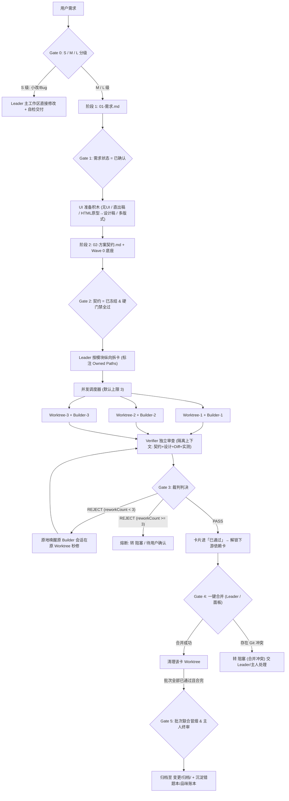

# 工作团队 2.0 规范与改造蓝图

> 状态：已定稿蓝图（待按 P0 → P1 → P2 逐步落地）  
> 参考来源：旧个人规范（`01~04`：生命周期 / 开发计划 / 执行自检）、GitHub Spec Kit、OpenSpec、Superpowers、BMAD-METHOD，以及 `pi-app` 既有看板实现（见 [team-board-panel.md](team-board-panel.md)）。

---

## 一、设计背景与核心理念

### 1.1 新旧对比与痛点诊断

| 来源 | 值得继承的精华 | 需要剔除的缺陷 |
|---|---|---|
| **旧个人规范（`01~04`）** | 1. **计划与契约分离**：总控计划管任务/依赖/验收命令，实施指南管目录/API/表/错误码；<br>2. **硬门禁与开工决策**：未落地前置项禁止写对应业务代码，决策增补不覆盖；<br>3. **S2 自检 + 3 轮熔断**：验收命令跑通才标完成，失败最多修 3 轮，超限停手等决策。 | 偏「单 Agent + 人」视角，缺少独立裁判与多模块并发隔离，自己写自己测容易放水。 |
| **工作团队 1.0（现状）** | 1. **Markdown 单一真相**：`看板/当前批次.md` 人类可读，与面板共享数据源；<br>2. **工程底座扎实**：文件锁、看门狗超时、结构化回执、卡片级审批、后台会话不抢焦点。 | 1. **一刀切禁 Leader 写代码**：小活也要拆卡派发，流程过重；<br>2. **缺技术契约与项目宪法**：PRD 直接跳任务卡，并发缺少统一接口/目录约定；<br>3. **门禁无系统强制力**：草稿也能直接派发；<br>4. **单点工位排队**：固定 1 前端 + 1 后端，多模块串行堵塞；<br>5. **返工挂起**：测试打回时原执行者已切走干别的，返工响应慢；<br>6. **依赖锁死人工验收**：流水线每张卡都卡在等主人点「已验收」。 |

### 1.2 2.0 五条核心理念

1. **分级路由（小活直干，大活分派）**：按任务复杂度走 S / M / L 三档轨道，日常零碎改动由 Leader 直接解决。
2. **纵向切片并发（一卡一 Worktree）**：取消固定「前端 / 后端」单点排队，改为按模块纵向切分，动态派生并发 `Builder` 实例，一卡一个独立 Git Worktree，返工原地秒唤醒。
3. **四层资产 + 契约先行**：用「宪法 → 需求 → 方案契约 → 看板」管住并发边界，共享骨架与目录所有权提前冻结。
4. **独立裁判 + 3 轮熔断**：`Verifier` 隔离上下文只认证据不看执行聊天，打回原地修，满 3 轮强制熔断交主人拍板。
5. **模型策略极简透明**：**不在团队层新增模型路由引擎**，每个角色静态绑定最合适的模型与思考深度，职责清晰、排查直接。

---

## 二、Gate 0：S / M / L 三档分级路由

每次向 Leader 提需求时，先经过 **Gate 0 复杂度分流**。Leader 动手前需用一句话报备判定级别，**主人随时可一句话覆写**（如「直接你改」或「走完整团队」）。

| 档位 | 适用场景 | 执行者 | 产物要求 | 质检与门禁 |
|---|---|---|---|---|
| **S 级（快车道）** | 明确小 Bug、文案/样式微调、配置修改、单文件/极小范围改动、纯调研 | **Leader 在主工作区直接动手**，不建卡、不派发 | 不写 Spec，不建看板卡（交付时附改动文件与自检结果） | 跳过团队门禁，Leader 自行按需跑单测/lint |
| **M 级（轻协作）** | 单个完整小功能、老项目加单一页面、跨 2~5 个文件 | Leader 评估后自干，或拆 **1~3 张卡**派发（可单 Worktree 或顺序执行） | 一页精简 `01-需求与契约.md`（范围 + 接口/数据 + 验收标准） | **推荐开启 Verifier**：抽查 Diff 与验收项 |
| **L 级（完整流水线）** | 新项目从 0 启动、大功能模块、核心架构重构、多模块并发 | **强制分派**（Leader 只做架构、契约、Wave 0 底座、拆卡、合并与收口，不写业务代码） | 完整四层资产：`00-宪法.md` + `01-需求.md` + `02-方案契约.md` + `03-看板.md` | **强制全门禁**：每卡必须过 `Verifier`，批次结束过联合冒烟 |

---

## 三、UI 准备积木（支持 4 种设计模式）

前端/UI 设计不再死绑成编码阶段的常驻工位，而是作为**开发前置的 UI 准备积木**。立项或新建批次时按项目实际选择其一：

| 模式 | 适用场景 | 完整流转路径 | 冻结后流向 |
|---|---|---|---|
| **1. 无 UI（跳过）** | 纯后端、CLI、底座重构、S 级小改 | 直接跳过设计阶段 | 直接进入契约冻结或 S 级执行 |
| **2. 直接出设计稿** | 从 0 开始 · 结构简单的项目 | `PRD 确认` → `拆模块` → `Designer` 直接出各模块大致设计稿 → **主人审定冻结** | 设计稿入 `变更/当前批次/设计/`，Builder 并发还原 |
| **3. HTML 原型 → 设计稿** | 从 0 开始 · 页面/流程复杂、容错率低的项目 | `PRD 确认` → `拆模块` → 先快速生成可点击 **HTML 简易模型原型**（存 `原型/`）→ **Gate 1.5：主人逐页确认内容与流程** → `Designer` 照冻结原型出精修设计稿 → **Gate 1.8：主人审定冻结** | **冻结的 HTML 原型（管字段与交互流程）+ 冻结的设计稿（管视觉还原）**共同作为 Builder 实现与 Verifier 截图验收基准 |
| **4. 单页多版式比选** | 老项目维护中新增一个页面或局部改版 | 跳过重型 PRD → `Designer` 针对该页面出 **2~3 个版式方案** → **主人挑定一版冻结** | 按选定版式入 `设计/`，走 M 级卡（或单一 Builder）还原 + Verifier 截图核对 |

> **关键规则**：设计定稿一经主人确认冻结，即成为只读契约资产，`Designer` 退场；开发阶段的视觉还原制衡由 `Verifier` 拿着「冻结原型/设计稿 + 实际运行截图」直接卡控，避免设计师与前端在编码期来回拉扯。

---

## 四、四层项目资产与可归档目录结构

借鉴 Spec Kit 的持久化分层与 OpenSpec 的变更归档机制，`.文档/` 目录规范如下：

```text
<项目根>/.文档/
├── 00-宪法.md                   # 【长期稳定】技术栈、目录架构、编码红线、全局硬门禁
├── 记忆/
│   ├── 错题本.md                # 踩坑/返工/熔断根因沉淀（派发时按标签摘要注入对应角色）
│   └── 品味账本.md              # 主人的审美取向与交互偏好（派发给 Designer/前端类卡时注入）
├── 角色配置.json                # 角色 → 模型 / 思考深度 / 启用开关（无额外团队级路由引擎）
├── 角色配置.md                  # 面板同步的人读镜像
├── 协作/
│   └── 团队.json                # 角色常驻会话映射、任务派发记录、Worktree 绑定状态
└── 变更/
    ├── 当前批次/                # 【当前活跃工作区】
    │   ├── 01-需求.md           # Spec：背景、目标、模块范围、验收标准（状态：草稿 / 已确认）
    │   ├── 02-方案契约.md       # Plan/Contract：接口、表结构、Wave 0 底座、Owned Paths、硬门禁（状态：草稿 / 已冻结）
    │   ├── 03-看板.md           # Tasks：任务索引、卡片详情、依赖、Worktree、返工计数、验收勾选
    │   ├── 原型/                # 冻结的 HTML 简易原型（模式 3 使用）
    │   ├── 设计/                # 冻结的设计稿与拆分资源（模式 2/3/4 使用）
    │   └── 验证/                # S2 自检输出、Verifier 审查截图与批次冒烟记录（原 poc/）
    └── 归档/
        └── <YYYY-MM-DD-批次名>/ # 批次已验收后一键整体归档，保持当前批次上下文轻量干净
```

### 老项目兼容策略
- 当前 `pi-app` 实现为平滑兼容既有项目，默认直接在 `.文档/开发规范/` 下生成并维护 `00-宪法.md`、`02-方案契约.md`、`看板/当前批次.md` 与 `归档/`；已初始化的老项目看板无需迁移即可直接沿用 2.0 角色、门禁与 Worktree 并发能力。

---

## 五、3+1 弹性角色与模型策略

### 5.1 角色定位与制约关系

| 角色 | 定位 | 权限边界 | 模型绑定建议 |
|---|---|---|---|
| **Leader** | 总控 / 架构师 / S 级独行侠 | **S 级可直接在主工作区改代码**；M/L 级负责 Spec、方案契约、Wave 0 底座、拆卡、并发调度、合并分支；**无权自批「已通过」或「已验收」** | 强推理、强架构模型 |
| **Builder** | 动态并发执行池（1 卡 1 会话 1 Worktree） | 纵向打通单张模块卡的前后端代码与单测 + S2 自检；**严格只改卡片 `ownedPaths` 范围内文件**；被裁判打回时**原地唤醒原会话在原 Worktree 秒修** | 高性价比强编码模型 |
| **Verifier** | 独立质检裁判（只读 / 跑验证，不改业务代码） | **上下文隔离**：不读 Builder 聊天过程，只读 `02-方案契约.md` + 原型/设计稿 + 验收项 + Worktree Diff + 实测/截图证据；**唯一有权将卡推进到「已通过」或打回返工的角色** | 独立审查强模型（与 Builder 交叉制衡） |
| **Designer** *(可选)* | 前置视觉设计专才 | 按第 3 节 4 种模式产出原型/设计稿/多版式方案；冻结后即退场 | 视觉与审美能力强的模型 |

> 注：极少数强异构栈项目（如原生客户端 + 独立后端），仍可在团队设置里把不同模型预设映射到对应任务卡的 `Builder`，而不恢复「全项目只能跑 1 个前端 + 1 个后端」的串行锁。

### 5.2 并发上限与排队策略
- **默认并发上限：`3`**（面板团队设置支持配置 **`1 ~ 6`**）。
- 同时派发超过上限的独立卡片进入并发队列，前一张卡通过并清理/收口后自动顶上，兼顾本地内存/端口占用、API 限流控制与分支合并可控性。

### 5.3 模型策略声明
- **不集成复杂模型路由**：工作团队层只保留「按角色静态绑定模型 + 思考深度」。因为不同角色已经按决策属性拆开，保持显式静态绑定即可做到成本可控、行为可预期、故障易排查（如用户自行使用全局配置好的虚拟模型 ID 也可直接被角色下拉选择，无需团队层额外维护一套规则）。

---

## 六、精简 5 泳道状态机 + 五道系统级硬门禁

### 6.1 泳道定义

去掉语义模糊的 `实现完成`，统一收敛为 **5 条主泳道 + 1 条异常侧挂道**：

1. **待办**：已拆卡，等待派发（前置依赖未 `已通过` 或受并发上限排队中）。
2. **进行中**：已创建独立 Worktree 并派发给 `Builder` 执行中（或被打回返工中）。
3. **待审查**：`Builder` 会话结束，等待 `Verifier` 独立审查 Diff、测试与视觉证据。
4. **已通过**：`Verifier` 给出 `PASS` 判决，**自动解锁下游依赖卡**，可立即执行分支合并。
5. **已验收**：主人最终确认（或批次收尾时批量验收），准备归档。
- **阻塞** *(侧挂)*：承接 4 类异常——`待用户确认`（卡片级高危审批或 **3 轮返工熔断**）、`合并冲突`、`缺环境/工具`、`外部依赖`、`执行失败`。

### 6.2 并发与门禁流转全景



### 6.3 五道硬门禁细则（必须由系统层强制卡控）

| 门禁 | 卡控时机 | 校验条件 | 未通过时的系统行为 |
|---|---|---|---|
| **Gate 1 · 需求门禁** | 拆卡 / 冻结方案前（L 级） | `01-需求.md` 头部状态必须为 `已确认` | 拒绝进入方案冻结与批量建开发卡 |
| **Gate 2 · 契约与底座门禁** | 派发 `Builder` 编码卡前（L 级） | `02-方案契约.md` 状态为 `已冻结`；所有「开工硬门禁」已勾选；并发卡之间的 `ownedPaths` 无明显目录冲突 | 禁止调用 `dispatch` 抢跑 |
| **Gate 3 · 独立质检与 3 轮熔断** | `Builder` 结束进入 `待审查` 后 | `Verifier` 核对验收项、单测/构建结果与视觉截图后给出 `PASS` 或 `REJECT` | `REJECT` 时 `reworkCount + 1`，原地唤醒原 `Builder` 返工；`reworkCount >= 3` 强制转 `阻塞 / 待用户确认` |
| **Gate 4 · 依赖解锁与一键合并** | 派发下游卡 / 合并分支 | 前置依赖卡状态为 `已通过` 或 `已验收` 即可解锁下游；合并时检查目标分支工作区洁净度 | 依赖未 `已通过` 拒绝派发；合并冲突时中止合并、保留现场并标 `阻塞` |
| **Gate 5 · 批次终审与归档** | 批次内所有卡合并完成后 | 执行整批联合冒烟并记录至 `验证/`，主人点击「批次验收并归档」 | 未完成所有卡片或未确认终审前不可归档 |

---

## 七、`pi-app` 分阶段代码改造路线图

为保证平稳演进、每一步都立即可用，按 **P0 → P1 → P2** 三阶段改造现有代码：

### 阶段 P0：打通快车道 + 并发 Worktree + 畅通流水线（先让团队丝滑好用）

| 模块 / 文件路径 | 改造内容 |
|---|---|
| [packages/shared/team-board.ts](file:///f:/maxv/PI/pi-app/packages/shared/team-board.ts) | 1. **角色升级**：扩展并迁移角色集合为 `Leader / Builder / Verifier / Designer`，在 `ROLE_ALIASES` 保留对旧角色名（`前端 / 后端 / 质量测试 / 设计师`）的向后兼容读取；<br>2. **泳道精简**：将 `TEAM_STATUSES` 中的 `实现完成` 替换为 `已通过`（保留旧名映射）；<br>3. **卡片结构扩展**：支持解析与写回 `worktreePath`、`branch`、`ownedPaths`、`reworkCount` 字段；<br>4. **提示词重构**：重写 `ROLE_CORE_RULES` 与 `buildTeamRoleIntro`——落地 Gate 0（S/M/L 分级路由，解除 S 级禁止 Leader 写代码的限制），明确 Builder 纵向开发与 Verifier 独立裁判准则。 |
| [src/main/team-board-ops.ts](file:///f:/maxv/PI/pi-app/src/main/team-board-ops.ts) | 1. **并发调度与 Worktree 隔离**：派发 `Builder` 卡时校验最大并发数（默认 3，可配 1~6），复用 [src/main/git-worktree-ops.ts](file:///f:/maxv/PI/pi-app/src/main/git-worktree-ops.ts) 的 `createGitWorktree` 为该卡创建独立分支与工作目录，并把 `cwd` 指向该 Worktree 启动后台会话；<br>2. **依赖解锁放宽**：前置依赖校验从 `status === '已验收'` 改为 `status === '已通过' || status === '已验收'`；<br>3. **一键合并与清理**：新增 `mergeTeamTaskWorktree`，合并成功后自动调用 `removeGitWorktree` 清理目录；冲突时标 `阻塞`。 |
| [src/main/team-board.ts](file:///f:/maxv/PI/pi-app/src/main/team-board.ts) | 1. 支持读取 2.0 目录结构（`变更/当前批次/`），同时兼容老项目 `.文档/开发规范/`；<br>2. 更新初始化模板，包含 `00-宪法.md`、`01-需求.md`、`02-方案契约.md`（含 UI 模式标记与 Wave 0 / 硬门禁区块）。 |
| [src/worker/worker-team-tools.ts](file:///f:/maxv/PI/pi-app/src/worker/worker-team-tools.ts) & [src/main/team-board-tool-bridge.ts](file:///f:/maxv/PI/pi-app/src/main/team-board-tool-bridge.ts) | 1. `team_board` 工具支持新角色与 `已通过` 状态；<br>2. 新增 `action=merge_task`，允许 Leader 在面板或对话中一键合并指定已通过卡片的 Worktree 分支。 |
| `src/renderer/src/features/team-board/*` | 1. 角色坞适配 `Leader / Builder / Verifier / Designer`，支持配置**并发上限（1~6）**；<br>2. 泳道更新为 `待办 / 进行中 / 待审查 / 已通过 / 已验收 / 阻塞`；<br>3. 卡片详情展示分支名、Worktree 路径、返工次数，为 `已通过` 卡片提供「一键合并」按钮。 |

### 阶段 P1：做硬门禁与独立制衡闭环

| 模块 / 文件路径 | 改造内容 |
|---|---|
| `src/worker/worker-team-tools.ts` & `src/main/team-board-tool-bridge.ts` | 新增 `action=review_verdict`（仅 `Verifier` / 人工可用）：<br>• `verdict=pass` → 卡片自动落入 `已通过` 并可触发下游依赖提醒；<br>• `verdict=reject` → `reworkCount + 1`，附带结构化缺陷清单，若 `< 3` 则**原地唤醒该卡原 `Builder` 会话在原 Worktree 返工**；若 `>= 3` 则强制熔断进入 `阻塞 / 待用户确认`。 |
| [src/main/team-board-ops.ts](file:///f:/maxv/PI/pi-app/src/main/team-board-ops.ts) | 落地 **Gate 1 / Gate 2 系统校验**：L 级模式下，检测 `01-需求.md` 非 `已确认` 或 `02-方案契约.md` 非 `已冻结` / 存在未勾选硬门禁时，阻断 `dispatchTeamTask` 并返回明确缺口提示。 |
| [src/main/team-board.ts](file:///f:/maxv/PI/pi-app/src/main/team-board.ts) & `packages/shared/team-board.ts` | 在卡片进入 `待审查` 时支持自动/一键拉起 `Verifier` 会话；派发 `Builder` / `Designer` 提示词时自动截取注入 `记忆/错题本.md` 与 `记忆/品味账本.md` 的最近相关条目。 |

### 阶段 P2：批次归档与经验自动沉淀

| 模块 / 文件路径 | 改造内容 |
|---|---|
| `src/main/team-board.ts` & `src/main/ipc/handlers/team-board.ts` | 新增 `archiveTeamBatch` IPC：校验批次内卡片全部处理完毕后，将 `变更/当前批次/` 整体归档至 `变更/归档/<YYYY-MM-DD-批次名>/`，并生成干净的下一批次模板。 |
| `src/renderer/src/features/team-board/*` | 1. 增加「批次验收并归档」一键按钮与批次初始化向导（支持选 S/M/L 与 4 种 UI 模式）；<br>2. 在驳回、3 轮熔断或批次归档时提供快捷入口，将教训/偏好一键写入 `记忆/错题本.md` 与 `记忆/品味账本.md`。 |
